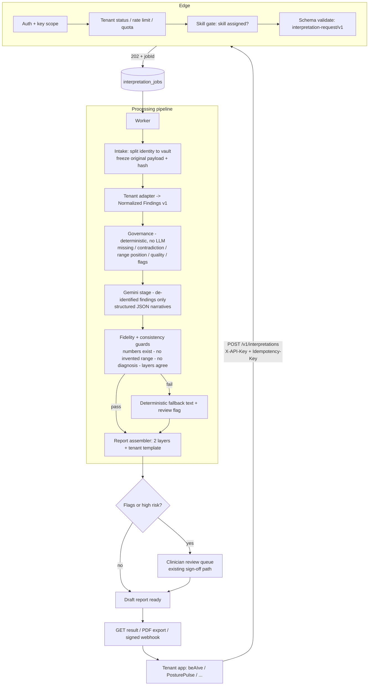
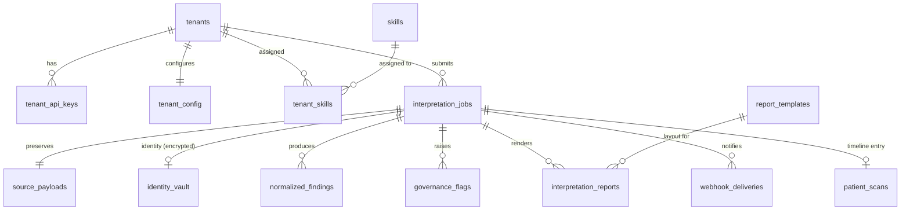
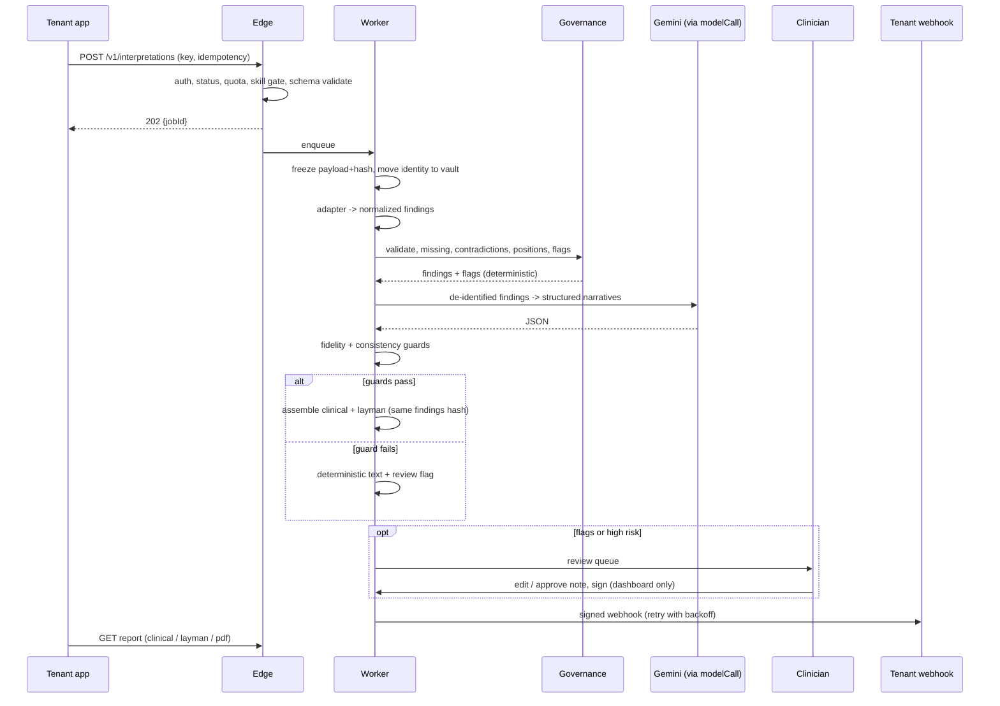

# Anukla (ANUClaw) — Multi-Tenant Medical-AI Interpretation & Reporting Engine: Architecture

**Version:** 0.1 (P0) · **Status: proposed architecture, awaiting owner review.** This document records no clinical validation, no regulatory clearance, no approved reference range and no deployment approval. Nothing here changes the existing release gates in [`PRODUCTION-READINESS-PLAN.md`](PRODUCTION-READINESS-PLAN.md) and [`CLINICAL-CONTENT-RELEASE.md`](CLINICAL-CONTENT-RELEASE.md). Build and test with **synthetic fixtures only** until those gates and the data-processing agreements are cleared.

"Anukla", "NexArc" and "ANUClaw" are the same product; this document uses ANUClaw.

Companion files: [`contracts/interpretation-request.v1.schema.json`](contracts/interpretation-request.v1.schema.json), [`contracts/normalized-findings.v1.schema.json`](contracts/normalized-findings.v1.schema.json), and synthetic examples under [`contracts/examples/`](contracts/examples/) (both examples validate against the request schema; the schemas compile in strict mode).

---

## 1. Concept analysis

**What it is.** Third-party health apps (tenants) run their own detection AI. They POST that structured output to ANUClaw. ANUClaw (a) validates and normalises it, (b) applies deterministic, LLM-independent governance, (c) uses Gemini only to *explain* the validated findings, and (d) produces two reports from the same finding set: a **Clinical Report** and a **Layman Report**.

**What it is not.** It does not re-detect anything, does not diagnose, does not replace a clinician, and does not let any model invent a measurement, a range or a diagnosis.

**Deliberate refinements to the brief** (each is a safety decision, flagged for your approval):

| Brief wording | Refinement | Why |
|---|---|---|
| Layman report states "which parameters are normal or abnormal, where validated reference ranges exist" | The layman layer says *inside / outside the range this app uses* for **tenant-supplied** ranges, and uses the words *normal / abnormal* only for ranges **released through the ANUClaw register** (none exist today) | The repo ships zero released clinical content; "no threshold may be taken from model output" (`CLINICAL-CONTENT-RELEASE.md`). A tenant's own range is relayed and labelled as theirs, never endorsed. |
| Clinical report includes "clinical significance" and "abnormal findings" | Phrased as *position relative to the stated reference* plus a **clinician-approved note** for any named clinical category (e.g. a named blood-pressure stage). The LLM may *draft* that note for a clinician to edit and approve; nothing reaches a released report without that sign-off. | The prohibited-claims rule in [`CLINICAL-CONTENT-RELEASE.md`](CLINICAL-CONTENT-RELEASE.md) and the clinician-only sign-off already in `src/documents/workflow.ts`. (The PosturePulse repo's own `docs/claims-and-scope.md` is stricter still and applies to PosturePulse's own copy.) |
| Clinical review and sign-off are done by ANUClaw | ANUClaw runs an **automatic AI clinical review** on every report (no human in the loop). The result is labelled `ai_reviewed` on every page, in the API and in webhooks. The words *signed*, *clinician-reviewed* and *approved by a clinician* are reserved for `clinician_signed`, which only a named licensed clinician can set in the dashboard; the public API and the AI can never set it (`POST /v1/reports/:id/review` already returns 403). | An AI cannot hold a licence or accept clinical responsibility, and the existing rule (`src/documents/workflow.ts`, `CLINICAL-CONTENT-RELEASE.md`) is clinician-only sign-off. Mislabelling an AI review as a signature would be a false claim. |
| High-risk findings (your brief, section 6, and your instruction that the patient be told to see a clinician or expert) | Any high-risk finding produces a **mandatory referral advisory** in both reports telling the patient to see a clinician or other expert. The report is still delivered immediately as `ai_reviewed`. Jobs with a `blocking` **data-quality** flag (contradiction, implausible value) are instead held in `awaiting_clinician`, because the narrative itself could be wrong. High-risk jobs also add a non-blocking follow-up item to the clinician queue. | Directing the patient to professional review is the protective action and needs no threshold from a model. The advisory wording is static, clinician-authored text, never LLM output. The beAIve sample (high blood-pressure, HbA1c and glucose risk markers) is exactly this case. |

## 2. Gaps and risks (from the code audit)

| # | Finding | Where | Consequence |
|---|---|---|---|
| G1 | Registration is public self-service; no admin tenant create/suspend; one key per tenant; no revoke / regenerate / expiry for tenant keys | `src/api/routes/tenants.ts`, `tenant-store.ts` | Cannot onboard or cut off a medical tenant safely. |
| G2 | **Security defect:** any tenant can change its own plan (`PUT /account/plan`); `PLAN_LIMITS` stored as zeros | `routes/tenants.ts`, `tenant-store.ts:35` | Tenants can raise their own limits. Fix in P1. |
| G3 | Intake exists only for documents/PDFs; no generic JSON ingest. *(Correction to the first audit:)* a PosturePulse-specific importer **does** exist at `src/integrations/posturepulse/` — it validates against PosturePulse's own JSON schemas (assessment-report, consent-record, session, symptom-report, metric-result) and tags data `upstream_verified`, `signed_bundle_verified` or `unverified_payload`. No beAIve code exists. | `src/api/routes/baas-v1.ts`, `src/integrations/posturepulse/*` | New generic ingest path required; the PosturePulse adapter must build on the existing importer and **preserve its verification tier** rather than re-implement it. |
| G4 | Skills are files mounted into every container; any tenant can run any skill | `src/container-runner.ts:293-312`, `src/api/routes/skills.ts` | No per-tenant skill control. |
| G5 | Fully synchronous; webhook URL stored but never called; job runtime is in-memory | `routes/tenants.ts:102`, `src/engines/jobs/*` | Need persistent jobs, 202 + polling, signed webhook sender. |
| G6 | Model config is global; new Gemini ids rejected by `checkModelIdentity` until registered | `src/ai/openrouter.ts` | Per-tenant model allow-list + identity registration. |
| G7 | `audit_events` has no `tenant_id`; API activity and admin changes are not tamper-evident per tenant | `db/connection.ts:160` | Extend, reuse `src/cds/audit/*`. |
| G8 | No vitals/posture reference ranges are released | `docs/clinical-release-register.json` (`releases: []`) | Ranges can only be tenant-supplied until released. |
| G9 | No structured per-scan findings or comparison | `patient_analyses.result` is free text | New findings tables for longitudinal use. |
| G10 | beAIve payloads carry name/email/phone | sample report | Identity must be split off before any LLM stage. |
| G11 | Several shared files are being edited by another session (AlphaFold) | `baas-v1.ts`, `openapi-v1.ts`, `db/connection.ts`, `shared-limits.ts` | New code in new modules; shared-file edits wait for confirmation. |
| G12 | A model-key probe showed `google/gemini-4-hydrogen` and `-argon` usable and `-neon` / `-carbon` refused by OpenRouter for the current key | probe, Nov 2026 | Model selection must be an admin-validated allow-list, tested per key, never free text. |

## 3. System architecture



**Invariants (enforced by code, not by the prompt):**

1. **Original preservation.** The tenant's payload is stored immutably with its SHA-256 before anything else runs.
2. **No identity downstream of intake.** Direct identifiers live only in the encrypted identity vault; findings, prompts and reports reference `subjectRef`.
3. **LLM-independent governance.** Every flag, range position and review decision is computed by deterministic code *before* the LLM runs; the LLM output can add prose but cannot change a finding, a position or a flag (same principle as `src/cds/clinical/arbitrate.ts`: no recommendation originates from the LLM).
4. **One finding set, two layers.** Both reports are rendered from the same `normalized-findings/v1` document and both stamp its `findingsSha256`.
5. **Three-way labelling** in every report: *source AI finding* / *ANUClaw interpretation (draft)* / *confirmed clinical diagnosis (only a signed clinician note)*.
6. **Fail closed.** Any validation or guard failure yields no LLM text (deterministic template instead) plus a review flag; it never yields "best effort" prose.

## 4. Component architecture

| Component | Responsibility | Module (new unless stated) | Reuses |
|---|---|---|---|
| Edge / auth | Key check, tenant status, scope, rate, quota, skill gate, validation | `src/interpretation/edge/*` | `requireAuth`, `perTenantRateLimit`, `quotaCheck`, `usageMeter`, `idempotent()` (`baas-v1.ts`), `shared-limits.ts` |
| Tenant admin | Tenant CRUD, suspend, keys, config | `src/interpretation/admin/*` + dashboard routes | `requireDashAuth`, `requireRole` |
| Skill registry | Skill manifests, tenant assignment, gate | `src/interpretation/skills/*` | manifest idea from `anuclaw-medical-report-analyzer` skill |
| Intake | Identity split, immutable payload, hash | `src/interpretation/intake/*` | AES-256-GCM helper pattern (`src/research-studio/ai-settings-crypto.ts`), content hashing (`src/cds/hashing`) |
| Adapters | Source format -> Normalized Findings | `src/interpretation/adapters/{beaive,posturepulse}.ts` | schemas in `src/interpretation/contracts` |
| Governance | Deterministic checks and flags | `src/interpretation/governance/*` | `src/cds/safety/missing-data.ts`, `src/cds/explanation/consistency-guard.ts` |
| LLM stage | Prompts, schema, call, retry | `src/interpretation/llm/*` | `modelCall()` (`src/ai/openrouter.ts`), `src/ai/spend.ts`, pattern of `src/ai/engine-review-service.ts` |
| Report assembler | Two layers, templates, PDF | `src/interpretation/reports/*` | `StructuredReport` ideas (`src/documents/report.ts`), Playwright (already a dependency) |
| Review | Flag queue, clinician sign-off | `src/interpretation/review/*` | `reviewReport` gate (`src/documents/workflow.ts`) |
| Delivery | Job status, signed webhooks | `src/interpretation/delivery/*` | `idempotency_keys` |
| Audit | Tenant-scoped hash-chained events | `src/interpretation/audit/*` | `src/cds/audit/{hash-chain,per-tenant}.ts` |
| Longitudinal | Timeline and compare | `src/interpretation/longitudinal/*` | the minimal-detectable-change idea from the **PosturePulse repo's** `services/ml-service/app/analysis/mdc.py` (a reference to port from, not an ANUClaw dependency) |

## 5. Multi-tenant data model

All new tables carry `tenant_id` (NOT NULL unless stated), are created idempotently, and are accessed only through functions that take the authenticated tenant (cross-tenant lookups return 404, matching `owned()` in `baas-v1.ts`).



| Table | Key columns | Notes |
|---|---|---|
| `tenants` (existing) | + `status` values `pending/active/suspended/revoked` | admin-created only for clinical tenants |
| `tenant_api_keys` | id, tenant_id, key_hash, key_prefix, label, scopes, expires_at, revoked_at, last_used_at, created_by | replaces the single `tenants.api_key_hash`; many keys, rotate/revoke |
| `skills` | id, version, manifest_json, risk_tier, requires_release, enabled | registry |
| `tenant_skills` | tenant_id, skill_id, enabled, config_json | assignment |
| `tenant_config` | tenant_id, gemini_model, llm_daily_budget_usd, report_template_id, de_id_required, adapter_id, input_schema_id, webhook_secret_ref, restrictions_json | per-tenant behaviour |
| `interpretation_jobs` | id, tenant_id, skill_id, status, idempotency_key, tenant_request_id, subject_ref, attempts, error_code, created/started/finished_at | status: `queued processing completed completed_with_flags failed cancelled` |
| `source_payloads` | job_id, payload_json (immutable), payload_sha256, schema_version | trigger blocks update/delete (pattern used by research-studio tables) |
| `identity_vault` | job_id, tenant_id, ciphertext, iv, auth_tag | AES-256-GCM, key from env, fail closed when unset |
| `normalized_findings` | job_id, finding_key, source_key, value_json, unit, value_status, derivation_json, uncertainty_json, confidence, reference_json, position, source_flag, under_research | the single source of truth for both layers |
| `governance_flags` | job_id, type, severity, finding_keys, detail, resolved_by, resolved_at | |
| `interpretation_reports` | id, job_id, tenant_id, layer (`clinical`/`layman`), template_id, template_version, llm_model, prompt_version, findings_sha256, status (`draft released rejected`), **review_state** (`ai_reviewed awaiting_clinician clinician_signed clinician_rejected`), ai_review_json (checks run, guard results, model + prompt version), referral_json (level, reasons, advisory text id + version), content_json, content_sha256, supersedes_id, reviewed_by (only for `clinician_signed` / `clinician_rejected`) | versioned, superseding, never overwritten |
| `report_templates` | id, tenant_id (null = global), layer, version, definition_json | tenant can change name/brand only; governance block is fixed |
| `webhook_deliveries` | id, tenant_id, job_id, event, attempt, status, response_code, next_attempt_at, signed_at | tenant-visible delivery log |
| `patient_scans` | tenant_id, subject_ref, job_id, captured_at, skill_id, analysis_type | longitudinal index |
| `audit_events` (existing) | + `tenant_id` | plus a per-tenant hash chain for tenant / key / skill / config changes and processing events |

## 6. Tenant authentication and authorisation

- **Credentials.** One tenant, many keys: `amgi_live_` + 48 hex (existing format), SHA-256 hashed with a prefix, shown once. Admin can create, rotate (grace window for overlap), revoke and set expiry; `last_used_at` is updated. A revoked/expired key returns 401 `key_revoked` / `key_expired`.
- **Token exchange.** Keep `POST /v1/token` (1-hour JWT) for production use.
- **Authorisation layers (all must pass):** (1) tenant `status = active`; (2) key not revoked/expired and has scope `interpret`; (3) rate and quota; (4) **skill gate**: `tenant_skills` row present and enabled, else 403 `skill_not_assigned`; (5) `analysisType` is accepted by the skill manifest; (6) tenant clinical scope / BAA / allowed domains for skills whose `risk_tier` requires it (existing `tenants.scopes`, `baa_status`, `allowed_clinical_domains`).
- **Admin plane.** Dashboard auth with roles `admin` and `compliance`; every admin change is audited. **The tenant-side `PUT /account/plan` is removed** (G2); plan changes are admin-only.
- **Public registration.** Closed for clinical use; tenants are created by an administrator (decision recorded).

## 7. Modular skill registry

A skill is a DB row plus a code-registered adapter and prompt set, referenced by manifest:

```json
{
  "id": "physiological-signal-interpretation",
  "version": "1.0.0",
  "acceptsAnalysisTypes": ["face_scan_vitals"],
  "adapterId": "beaive-v1",
  "inputSchema": "interpretation-request/v1",
  "prompts": { "clinical": "clinical-vitals/v1", "layman": "layman-vitals/v1" },
  "riskTier": "ruo",
  "requiresRelease": false
}
```

Initial skills: Physiological Signal Interpretation (beAIve), Posture Analysis Interpretation (PosturePulse), Clinical Report Generation, Patient-Friendly Explanation. ECG, Medical Imaging, Biosensor and Medical Report Interpretation are **registry slots only** until a real adapter exists (no pretending). Assigning or removing a skill is an admin action with no deploy. The existing `container/skills/*` agent skills stay as agent tooling and are not the interpretation registry.

## 8. Normalisation layer

- Input: `interpretation-request/v1` (tenant format already wrapped in the common envelope) -> adapter -> `normalized-findings/v1`.
- The adapter is the **only** tenant-specific code. It maps keys to canonical keys, parses ranges, and applies deterministic *derivations* (never inferences).

**beAIve adapter (examples from the real sample layout)**

| Source row | Canonical findings | Status |
|---|---|---|
| `Blood Pressure 154/94 mmHg`, desired `<129/90` | `bp_systolic_mmhg = 154`, `bp_diastolic_mmhg = 94` (reference upper 129 / 90) | `derived` (rule `split_bp`), reference `tenant_supplied` |
| `Heart Rate 107 bpm`, `60-100` | `heart_rate_bpm = 107` | `stated`, position `above` (computed) |
| `Hemoglobin A1c 6.89%`, `<5.7`, `**` | `hba1c_percent = 6.89`, `underResearch = true` | `stated`, position `above`, flag `under_research` |
| `Hemoglobin 14.4 g/dL`, `M:14-18, F:12-16` | `hemoglobin_g_dl = 14.4` | sex-dependent range: position `indeterminate` unless `sexAtBirth` supplied (never guessed) |
| `High Fasting Glucose Risk: High` | categorical finding, `sourceFlag = high` | flag `under_research`; context `fastedBeforeScan = null` -> flag `missing_data` (source says disregard if not fasted) |
| value `null` | finding with `valueStatus = missing` | flag `missing_data`; never filled in |

**PosturePulse adapter.** Built on the existing `src/integrations/posturepulse/` importer (contract validation against PosturePulse's real schemas, upstream / signed-bundle / unverified tiers): the adapter converts what that importer already accepted, and carries its verification tier into the findings' provenance so a report can say how trustworthy the source data is. `AssessmentReportBody.rows[]` map directly: `estimate + uncertainty` -> `value + uncertainty`, `reference` -> tenant-supplied reference, `tier` -> `underResearch` / `not_measurable` -> `missing`, `excluded` rows keep their reason and are honoured by the layman layer. `position` is *recomputed* by ANUClaw governance, not trusted.

## 9. Clinical governance architecture

Order of deterministic stages (all before the LLM):

1. **Schema + semantic validation** — types, units, plausible physiological bounds (flag `implausible_value`; value is kept, never altered).
2. **Missing / inconsistent data** — reuse the `unknown` vs `confirmed_none` distinction from `src/cds/safety/missing-data.ts`; required context absent -> flag.
3. **Contradiction detection** — cross-finding rules (e.g. systolic below diastolic, source flag `normal` while value is outside its own stated range) -> flag `contradiction`.
4. **Reference handling** — compute `position` only against a present reference; origin `tenant_supplied` or `anuclaw_released`; uncertainty interval straddling a bound -> `indeterminate`. No reference -> `no_reference`.
5. **Confidence and quality** — source confidence is evidence only (`src/engines/types.ts` comment: "never decides"); low confidence -> flag.
6. **Review flags** — `blocking` or `attention` flags route the job to the clinician queue.
7. **Short-interval discrepancy (longitudinal)** — flagged when two scans disagree beyond what is biologically plausible within the interval (lesson from the earlier two-scan test).

**Flag catalog:** `missing_data`, `contradiction`, `low_confidence`, `out_of_source_range`, `under_research`, `stale_capture`, `unit_mismatch`, `implausible_value`, `review_required`.

**Automatic AI clinical review (no human).** After the guards pass, a separate review step re-checks the assembled report against the findings and records the outcome in `ai_review_json`: every statement traces to a finding, every position matches the deterministic one, no range or diagnosis wording was introduced, both layers agree, all flags are surfaced, and any required missing context is stated. It is deterministic code first, with an optional second Gemini pass in the style of `src/ai/engine-review-service.ts` (the model can only add or sharpen a limitation; it can never change a finding, a position or a flag). Passing sets `review_state = ai_reviewed`. This is the review ANUClaw performs by itself; it is never described as a clinician's review.

**Human review (clinician).** Jobs with a `blocking` data-quality flag are set to `awaiting_clinician` and enter the clinician queue (dashboard Clinical module). High-risk clinical indicators do not block delivery; they trigger the referral advisory below and add a non-blocking follow-up item to the same queue. Sign-off uses the existing clinician-only path (password re-check, content hash, supersede-not-overwrite); the API and the AI can never sign. A clinician may also sign any `ai_reviewed` report on request. Rejection records a reason; the next report version supersedes. If no clinician is available the report stays visibly `awaiting_clinician` with the banner; it never silently becomes final.

**Referral advisory (high-risk findings).** When any trigger below fires, both reports carry a prominent, non-removable advisory telling the patient to see a clinician or other qualified expert, and the delivery payload includes `referral: { level, reasons[], textId, textVersion }`.
- **Deterministic triggers** (no model involved): (a) the source flags a *risk-category* indicator `high` or `review`; (b) a finding marked high-risk in the skill manifest sits outside its tenant-supplied reference; (c) a `blocking` flag; (d) two or more `attention` flags on high-risk indicators; (e) `under_research` markers that are themselves flagged high (the advisory says these are experimental estimates to be confirmed with validated tests).
- **Wording is static and clinician-authored**, versioned and released through `docs/clinical-release-register.json`, with a layman variant and a clinical variant. The LLM never writes, shortens or softens it, and the guards reject any narrative that contradicts or omits it.
- **Levels:** `see_clinician_soon` for any trigger. A symptom-based safety-net paragraph ("seek urgent care if you have chest pain, difficulty breathing, fainting, confusion…") accompanies it. A numeric *urgent-now* level is **not** offered, because it would need a released threshold; it can be added only after such ranges go through the register.

**What governance will never do:** state a diagnosis, state a range that is not tenant-supplied or released, or change a source value.

## 10. Gemini integration architecture

- **Transport:** only `modelCall()` — hooks, restricted-content check, egress de-identification, spend reservation, retry, model-identity check. No raw HTTP.
- **Roles:** new `report_clinical` and `report_layman` roles in `modelRoles()`; per-tenant `gemini_model` is passed as `args.model` **after** an admin allow-list check.
- **Model identity:** each allowed id (`google/gemini-4-hydrogen`, `google/gemini-4-argon`, …) is added to `MODEL_IDENTITIES` with its dated-version rule; an id the provider refuses for the key stays off the allow-list (G12). The allow-list is verified per key with a cheap capability probe at admin-save time.
- **Input to the model:** de-identified normalized findings, flags, references and units — **no** identity, **no** raw payload, **no** `sourceNarrative` (excluded by default; allowed only after the egress de-identification pass).
- **Output contract:** strict JSON, e.g. `{"sections":[{"id","text","findingRefs":["hba1c_percent"],"statusLabel":"source_finding|interpretation"}], "nextSteps":[...], "limitations":"..."}` with `response_format: json_object`, low temperature, versioned prompts.
- **Guards (generalising `fidelityProblems` in `src/ai/engine-review-service.ts`):**
  - every number in text exists in the findings (with unit tolerance rules);
  - every statement cites at least one valid `findingRef`;
  - no reference range unless the finding carries one (and it is quoted from it);
  - no diagnosis assertion — **negation-aware and context-aware** (lessons from the prototype: *"does not support a diagnosis"* and *"should be confirmed with a clinician"* are required safe wording, so words like *diagnosis* / *confirmed* are only flagged without a negation or clinician/lab/device context);
  - clinical and layman layers agree on every position and flag (consistency check modelled on `src/cds/explanation/consistency-guard.ts`).
- **Failure policy:** one bounded retry; then deterministic template text + a `review_required` flag. A budget of `0`, an invalid budget, an unavailable model or a model-identity mismatch all fail closed (no narrative), never to a different model silently.
- **Cost:** per-tenant `llm_daily_budget_usd` via the existing spend ledger scope `kind: 'tenant'`; real cost recorded from the provider's `usage` field.
- **Provenance recorded on every report:** model id returned by the provider, prompt version, findings hash, guard results.

## 11. Report generation pipeline

- **Single assembler, two layers.** Inputs: `normalized-findings/v1` + guard-passed narratives (or deterministic fallback) + tenant template.
- **Clinical layer.** Clinical summary; source findings with units, uncertainty and source reference (labelled *supplied by <application>*); position vs reference; flags and data-quality notes; limitations; recommendation for professional review; full traceability block (tenant, source model/version, adapter, ruleset, LLM model + prompt version, findings hash, original payload hash). Any named clinical category appears only inside a *clinician-approved note* region.
- **Layman layer.** Plain-language explanation, what each flagged value is compared against (the app's own range), why it may matter in general terms, when to see a professional, questions to ask. Written to a reading-level target; no jargon without a gloss; **no** reassurance wording ("healthy", "nothing to worry about", "all clear").
- **Branding rule (owner requirement).** A tenant template may change the **product name / logo / colours**; the NexArch governance block and the "not a diagnosis" status banner are fixed and cannot be removed.
- **Status banner on every page** showing the `review_state`: *AI-reviewed, not reviewed by a clinician*, *Awaiting clinician review*, or *Signed by <named clinician>, <date>*. The banner and the NexArch governance block are part of the fixed layout.
- **Rendering.** HTML templates -> PDF with Playwright (already a dependency under `src/research-studio/browser`). The prototype templates in `posturepulse-report-template-build/` and `beaive-vitals-report/` are the starting visual design; they are ported, not extended in place.
- **Versioning.** A re-run or a clinician edit creates a new report version that supersedes the old one; both layers share the same `findingsSha256` so a mismatch is detectable.

## 12. API specification (v1, extends the existing `/v1` contract)

All endpoints: `X-API-Key` or Bearer JWT; `X-Request-Id` returned on every response; errors are `{ "error": { "code", "message", "requestId" } }`. The OpenAPI document is generated through the existing builder (`src/api/openapi-v1.ts`) and covered by the existing contract test.

| Method & path | Purpose | Notes |
|---|---|---|
| `POST /v1/interpretations` | Submit an analysis | body `interpretation-request/v1`; `Idempotency-Key` supported; returns **202** `{ jobId, status:"queued", statusUrl }`; sync-fast path optional later |
| `GET /v1/interpretations/:id` | Status + summary | `queued/processing/completed/completed_with_flags/failed/cancelled`, flag counts |
| `GET /v1/interpretations` | Processing history | paginated, tenant-scoped |
| `GET /v1/interpretations/:id/findings` | Normalized findings | no identity |
| `GET /v1/interpretations/:id/reports/{clinical\|layman}` | Report JSON; `.pdf`, `.html` exports | status `draft` until signed |
| `GET /v1/patients/:ref/timeline` | Scans for a subject | `ref` = tenant's `externalRef` |
| `GET /v1/patients/:ref/compare?from=&to=` | Old vs new | neutral wording; significance only when source gives uncertainty |
| `GET /v1/skills` | Skills assigned to caller | |
| `PUT /v1/account/webhook` | Set https URL | SSRF-guarded; returns signing secret once |
| `GET /v1/webhook-deliveries` | Delivery log | |
| `GET /v1/usage` | Requests, LLM spend | from usage log + spend ledger |
| `POST /v1/reports/:id/review` | **Always 403** | clinician sign-off is dashboard-only (existing behaviour) |

**Admin (dashboard auth, `admin`/`compliance`):** tenants CRUD + suspend/reactivate; keys create/rotate/revoke/expire; skills CRUD; `tenant_skills` assign; tenant config (model allow-list, budget, template, restrictions); usage; audit; flag queue; template CRUD.

**Error codes:** `validation_failed`, `unauthorized`, `key_revoked`, `key_expired`, `tenant_suspended`, `skill_not_assigned`, `analysis_type_not_supported`, `rate_limited`, `quota_exceeded`, `payload_too_large`, `idempotency_conflict`, `governance_blocked`, `llm_unavailable` (report degraded to deterministic), `not_found` (also used for cross-tenant ids).

**Async + webhooks.** Webhook events: `interpretation.completed`, `interpretation.completed_with_flags`, `interpretation.failed`, `report.signed`. Headers: `Anukla-Event-Id`, `Anukla-Signature: t=<unix>,v1=<hex HMAC-SHA256 over "t.body" with the tenant secret>`. Receivers reject timestamps older than 5 minutes. Retries with exponential backoff (1m, 5m, 30m, 2h, 12h), capped at 24h, then marked `dead` and visible in the delivery log. Destination rules: https only; DNS resolved and pinned; loopback / private / link-local / metadata ranges rejected; no redirects.

**Versioning.** `/v1` additive-only; breaking change -> `/v2` with `Deprecation` and `Sunset` headers; tenants pin the request `schemaVersion`.

## 13. Longitudinal comparison

`patient_scans` indexes each job by `(tenant_id, subject_ref, captured_at)`. `compare` returns per-finding earlier / later values and a neutral judgement: `within_uncertainty`, `beyond_uncertainty`, `not_comparable` (unit change, missing value, no uncertainty from the source). Never "improved" / "worsened". Significance testing may use the minimal-detectable-change approach (PosturePulse repo: `services/ml-service/app/analysis/mdc.py`, currently unused there) only for a metric that has test–retest data; otherwise the neutral combined-uncertainty rule (as already used in the PosturePulse mobile app's `apps/mobile/src/lib/compare.ts`) applies. A short-interval large disagreement raises the discrepancy flag instead of being presented as a trend.

## 14. Admin dashboard structure

Built in the existing NexArch visual language, role-gated and audited. Mapping of the twelve requested modules to the current state:

| Module | State today | Plan |
|---|---|---|
| Overview & analytics | exists (`Home`, NexArch `Overview`) | add tenant / job / flag tiles |
| Tenant management | missing | new |
| API integration management | partial (`ApiKeys`) | per-tenant keys, rotate/revoke, webhook + delivery log |
| Skill registry | listing only (`Skills`) | manifests, enable/disable |
| Skill-to-tenant assignment | missing | new matrix |
| Gemini configuration | missing | allow-list with per-key capability probe, budgets |
| Report template management | missing | tenant brand fields only; governance block locked |
| Clinical governance | partial (`Clinical`, `CDS`) | flag queue, sign-off, supersede history |
| Processing history | partial | job list, status, retry, error codes |
| API usage & billing | backend only | usage + LLM spend views |
| Audit logs | exists (`Audit`) | tenant filter, hash-chain verify |
| System settings | exists (`Settings`) | unchanged |

## 15. Security and privacy architecture

- **Data minimisation.** Identity is optional in the contract and stored only in the encrypted vault; findings, prompts, reports and webhooks carry `subjectRef`.
- **Encryption.** AES-256-GCM for the vault (key from environment, fail closed), TLS in transit, hashed keys and webhook secrets stored encrypted.
- **LLM egress.** De-identified findings only; `sourceNarrative` excluded by default; existing egress policy and restricted-content check stay on; `ELAB_DEID_REQUIRED` remains on until DPAs are signed.
- **Tenant isolation.** Every query is tenant-scoped; cross-tenant ids return 404; tests assert it for every new table.
- **Abuse controls.** Rate limit, monthly quota, per-tenant LLM budget, payload size cap, idempotency; webhook SSRF guard.
- **Audit.** Tenant-scoped hash-chained events for key, skill, config and processing changes; admin actions record actor and before/after.
- **Regulatory posture.** No medical-device claim; every report states it is a draft decision-support document. Applicability of data-protection laws (for example Malaysia PDPA, India DPDP, HIPAA where US data is involved) and data-residency per tenant is a legal assessment this document does not make; `tenants.residency` already exists to carry the tenant's declared requirement.
- **Open gap carried forward.** Consent withdrawal / deletion: tenants own consent; ANUClaw must provide a subject-erasure endpoint that removes vault, payloads, findings and reports for a `subjectRef` (hash-chained tombstone kept). Scheduled in P3.

## 16. Error handling and monitoring

- Stable error codes (section 12); `requestId` on every response and in every audit event.
- Worker: bounded attempts per job with backoff; poison jobs end `failed` with `error_code`; every stage emits a timing/outcome event.
- Metrics: queue depth and age, job success/flag/fail rates per tenant, LLM latency/cost/guard-reject rate, webhook success rate, key-auth failures, rate-limit hits. Alerts: queue starvation, guard-reject spike, spend near budget, webhook dead-letters, hash-chain verification failure.
- Degradation order: LLM unavailable -> deterministic template report + flag (still delivered); worker down -> jobs stay `queued` (visible), never silently dropped.

## 17. Deployment architecture

Single Node control plane (existing) + Postgres (existing) + a worker role running the same codebase (`INTERPRETATION_WORKER=1`) so the API process never blocks; Playwright runs in the worker. Secrets via environment/secret manager. Staged: local synthetic -> internal pilot -> restricted tenant pilot, each gated by the production-readiness gates. Rollback = additive migrations only; new tables never alter existing ones in a breaking way.

## 18. End-to-end workflow



## 19. Phasing and acceptance

| Phase | Deliverable | Acceptance (all tests use synthetic data) |
|---|---|---|
| **P0** | This document + the two contracts + examples | Contracts compile in strict mode; both fixtures validate; negative cases reject; owner review |
| **P1** | Admin tenant lifecycle, multi-key credentials (rotate/revoke/expire/last-used), **plan-escalation fix**, tenant-scoped hash-chained audit | Cross-tenant 404s; revoked/expired key 401; tenant cannot change own plan; audit chain verifies |
| **P2** | Skill registry tables, admin routes, assignment, gate | Unassigned skill 403 on the new endpoint and on skill-run; manifest validation |
| **P3** | Ingest endpoint, identity split, adapters (beAIve, PosturePulse), persistent jobs + worker, 202/status, signed webhooks with SSRF guard, subject erasure | Original payload immutable; no identifier in findings/prompt (asserted); webhook signature/retry/SSRF tests; idempotent replay |
| **P4** | Governance, per-tenant Gemini model + budget, guards, two-layer HTML->PDF reports, review queue | Numbers absent from findings are rejected; false-positive wording cases pass; layers agree; fallback path works; budget 0 refuses; the AI review can set `ai_reviewed` but never `clinician_signed` (asserted at API, DB-constraint and UI-copy level); blocking data-quality jobs end `awaiting_clinician`; every high-risk job carries the referral advisory in both layers (asserted, with static text id + version) and a narrative that omits or contradicts it is rejected |
| **P5** | Longitudinal timeline + compare | Neutral wording; `not_comparable` cases; discrepancy flag |
| **P6** | Admin dashboard modules (can start per module alongside P1–P3) | Role gating; accessibility checks consistent with the NexArch QA suite |

**Decisions already recorded by the owner:** build P0 docs then P1; new code in new modules, shared-file edits (`db/connection.ts`, `baas-v1.ts`, `openapi-v1.ts`, `shared-limits.ts`) wait until the owner confirms the AlphaFold session is done; HTML + Playwright for PDFs; tenants admin-created only. **Still open:** named clinical categories — clinician-approved note only (assumed) vs a reviewed reference-range pack through the release register; and whether synthetic-only data remains the rule until the readiness gates clear (assumed yes).

## 19a. P1 as built (tenant lifecycle and credentials)

Status: implemented and tested; **not committed**. Differences from the design above, and what changed for existing clients:

| Area | As built |
|---|---|
| Code location | `src/interpretation/tenancy/{keys,audit,lifecycle,admin-routes}.ts` plus small edits to `src/api/tenant-store.ts`, `src/api/middleware/auth.ts`, `src/api/routes/tenants.ts`, `src/api/server.ts` and the startup migration in `src/db/connection.ts` (one new table, `tenant_api_keys`) |
| Admin plane | Uses the existing fail-closed `X-Admin-Key` guard (503 if `ADMIN_API_KEY` is unset). It proves "an administrator", not which one, so an optional `X-Admin-Actor` is stored as an *unverified* label. Per-person admin identity and the role-gated dashboard plane remain P6. |
| Tenant status | Values stay `active` / `suspended` (the extra `pending` / `revoked` states in section 5 were not needed yet). |
| Keys | Many per tenant (max 10 active); create, rotate (default 24 h grace, `0` = revoke now, max 30 days), revoke (idempotent), expiry, last-used. `tenants.api_key_hash` is untouched, so a code rollback keeps the original key working; each tenant's legacy key is backfilled as a `legacy` row and a revoked row can never be revived. |
| Tokens | A JWT now carries the id of the key that minted it, so revoking or expiring that key ends its tokens. `POST /token` requires an API key (a token cannot mint a token). Tokens issued before this change have no key claim and simply expire within the hour. |
| Audit | Reuses `PostgresPerTenantAuditLog` (`cds_audit_log_mt`, append-only trigger). Each entry is written **in the same transaction** as the change, under a per-tenant advisory lock: a change and its record commit or roll back together, and concurrent actions keep the chain contiguous. Payloads never hold key material (enforced) and omit the tenant e-mail (domain only). |
| Security fix (G2) | `PUT /account/plan` now returns `403 plan_change_requires_admin`; the unauthenticated `updatePlan` helper was removed; only `PUT /api/v1/admin/tenants/:id/plan` changes a plan. |
| Registration | `POST /register` is **closed by default** (`403 registration_closed`); `ANUCLAW_SELF_REGISTRATION=open` re-enables it, always on the free plan (`plan_requires_admin` if another plan is sent). Duplicate-e-mail checks are now case-insensitive. |
| Error codes | `unauthorized`, `key_revoked`, `key_expired`, `tenant_suspended`, `api_key_required`, `registration_closed`, `plan_change_requires_admin`, `plan_requires_admin`, plus the admin API's `{error:{code,message,requestId}}` family. |
| Not yet done | Per-key **scope enforcement** (scopes are stored and exposed by `hasScope`, but no endpoint requires one until the skill gate in P2 / ingest in P3); `X-Admin-Key` comparison is a plain string compare inherited from the existing admin router (a constant-time comparison is a worthwhile follow-up there); the audit `entries` endpoint returns the whole chain (pagination when chains grow). |

## 19b. P2 as built (skill registry and per-tenant assignment)

Status: implemented and tested; **not committed**.

| Area | As built |
|---|---|
| Code | `src/interpretation/skills/{manifest,adapters,registry,admin-routes}.ts`, shared admin plumbing in `src/interpretation/tenancy/admin-http.ts`; tables `skills`, `tenant_skills`, `registry_state` in the startup migration; the gate is wired into `src/api/routes/skills.ts` |
| Two kinds, one table | `agent` skills (the files under `container/skills`, synced in as rows) and `interpretation` skills (manifest + code-defined adapter). Interpretation skills are registered by manifest only; agent skills can never be created through the API |
| Gate | `checkSkillAccess` is the single decision. Unknown, malformed, unassigned and switched-off skills all get the same `403 skill_not_assigned`. Then: `skill_disabled`, `skill_not_released` (always, while `requiresRelease` is set — there is no release mechanism yet, so it fails closed), `clinical_access_required` (scope + active BAA + enabled domain, re-checked on every use, so a lapsed BAA stops access), and `skill_unavailable` (503) when the adapter is not implemented. It runs after the cheap per-tenant rate limit and **before** the monthly quota and the agent-concurrency lease, so a refused call costs the tenant nothing. |
| Grandfathering (owner decision) | The first time the registry starts, every tenant that already exists is assigned every agent skill **once**, audited per tenant as `tenant.skills.grandfathered`. A marker in `registry_state` stops it ever repeating, so a skill an administrator removes stays removed. It is skipped, and retried next start, if no agent skills are found (a wrong working directory cannot burn the marker). Tenant creation initialises the registry first, so a brand-new tenant is never grandfathered by mistake. New tenants start with none. |
| Adapters | Declared in code (`adapters.ts`) as `beaive-v1`, `posturepulse-v1`, `report-clinical-v1`, `report-layman-v1`, all `available: false`. A manifest must name a known adapter whose analysis types cover the manifest's. A skill can be registered against an unavailable adapter, but cannot be assigned or run until P3 registers the implementation (`declareAdapter`). |
| Seeded skills | The four interpretation skills named in section 7. ECG, imaging and biosensor skills are **not** seeded: they need new adapter code first. |
| Versioning | A manifest change must carry a new version of the same id; enabling/disabling is separate. Skills are never deleted (the table's foreign key enforces it) — disable instead. |
| Audit | Assignments, unassignments and updates go on the tenant's chain; registrations and updates on the reserved `_platform` chain; same transaction as the change. Assignment *config values* are never audited, only their key names. |
| Side fixes | The old run route built a file path straight from the caller's skill name; ids are now checked against the registry (and a strict id pattern) before the file system is touched. The old 404 listed every skill name; it no longer does. A body-style request with a non-string `skill` is a 400. |

**Known limitations (not closed by P2):**

1. **The agent container still mounts every skill read-only** (`src/container-runner.ts`, `/workspace/skills`). A tenant allowed one agent skill can ask the agent to read another skill's `SKILL.md`. The files are instructions and code snippets, not secrets, and the container is isolated, but the gate controls who may *run* a skill, not what an already-running agent can read. Closing it means mounting only the tenant's allowed skills per run (a change to the container launch path).
2. **Per-key scopes** are still stored but not enforced (planned with the interpretation endpoint in P3).
3. **Tenant-facing `GET /v1/skills` for interpretation skills** arrives with P3's endpoint; today only the agent-skill list exists, and it shows assigned skills only.
4. **`requiresRelease`** denies unconditionally until a release mechanism (the clinical release register) can say otherwise.

## 20. Relationship to other documents

[`NEXARCH-UNIFICATION-AND-REPAIR-PLAN.md`](NEXARCH-UNIFICATION-AND-REPAIR-PLAN.md) step R1 (authorization and error truthfulness) overlaps P1; coordinate so the plan-escalation fix is made once. [`NEXARCH-SCIENTIFIC-PLATFORM-MASTER-PLAN.md`](NEXARCH-SCIENTIFIC-PLATFORM-MASTER-PLAN.md) covers research studios, not tenant interpretation; its tenant/artifact rules (owner scope, 404 on foreign ids) are followed here. This document supplements, and does not supersede, the clinical release and production-readiness rules.


## 19c. P3a as built (intake, queue, worker, beAIve adapter)

- Tables (`src/interpretation/jobs/schema.ts`, run by the startup migration): `interpretation_jobs`, `source_payloads` (immutable by trigger; identity already removed), `identity_vault` (AES-256-GCM, AAD = tenant|job|kid), `normalized_findings`.
- Idempotency is a database unique index on `(tenant_id, idempotency_key)` plus a stored request fingerprint; concurrent duplicates cannot both create a job.
- Queue: atomic claim with `FOR UPDATE SKIP LOCKED`, fenced by `claim_token` on heartbeat, failure and the final commit; expired leases are reclaimed; backoff `min(30 min, 30 s * 2^(n-1))`; permanent failures (`AdapterError`, missing adapter) skip retries.
- `source_payloads.payload_sha256` hashes the stored payload WITHOUT identity, so the hash cannot be used to test guesses about a person's name or email.
- beAIve adapter `beaive-v1` 1.0.0: derives systolic/diastolic from "SYS/DIA", keeps nulls as `missing` with a flag, applies a sex-dependent range only when `sexAtBirth` is female or male, keeps unknown keys as `unmapped.*` with an `unmapped_key` flag. No value or range is invented.
- Not yet built here: governance/LLM/reports (P4). PosturePulse is 19d, webhooks 19e, erasure 19f.


## 19d. P3b as built (PosturePulse adapter)

- Request contract: `findings` OR `nativePayload` (`posturepulse-assessment/v0`, with exactly one of `bundle` or `unsigned`); never both. Each adapter declares the one form it reads (`input: 'findings' | 'native'`).
- Verification runs at intake in the adapter's `prepare` hook, so a tenant gets an immediate refusal and nothing is stored. It reuses `verifyBundleEvidence` / `validateUnverifiedEvidence`, extracted from `src/integrations/posturepulse/service.ts` so the patient importer and the interpretation path share one definition of "verified". `run` stays pure.
- Verification level travels with the findings (`sourceVerification`) and is covered by `findingsSha256`, so a verified and an unverified copy of the same rows can never share a hash. Unsigned input is never upgraded and carries a blocking flag.
- Normalized-findings v1 gained: `side`, `stepId`, `signConvention`, `tier`, `sourcePosition`, `unsupportedReasons`, reference `status/kind/value`, top-level `sourceVerification`, `notMeasurable`, `symptoms`, and flag types `unverified_source`, `draft_reference`, `symptom_reported`.
- Deliberately not copied into findings: symptom free text and the clinician-assessment text (both stay only in the stored original payload; the assessment is noted by an info flag). A single-value reference is carried as a target, not a range, and no inclusivity is asserted where the source does not state one.


## 19e. P3c as built (signed webhooks)

- `src/security/ssrf-guard.ts`: https only, no credentials, port 443 or 1024-65535, internal-looking names refused, every DNS answer must be a public unicast address (a mixed public/private answer is refused), one validated address is returned and the connection is PINNED to it (`transport.ts` overrides the socket lookup; TLS verifies the real host name; redirects are never followed; responses are capped and discarded). The guard runs at registration and again on every delivery attempt.
- Tables (SQL in `jobs/schema.ts`): `tenant_webhooks` (one endpoint per tenant; secret sealed with AES-256-GCM under `ANUCLAW_WEBHOOK_SECRET_KEY`, separate from the identity-vault key, AAD = tenant and key id) and `webhook_deliveries` (the outbox).
- Outbox: the delivery row is written in the SAME transaction as the job's completion (`worker.ts`) or permanent failure (`queue.ts failAttempt`), so a state change and its notification both exist or neither does. It stores the exact bytes sent (ids, hashes, status; no PHI), unique per (job, event type).
- Delivery: claim with SKIP LOCKED and a fenced token; schedule 1 min / 5 min / 30 min / 2 h / 12 h, six attempts, dead after that or when it would still be pending 24 h after the first attempt. Each attempt is signed at its own time over the same bytes and event id. A removed webhook makes pending deliveries dead without sending.
- Signature: `Anukla-Signature: t=<unix>,v1=HMAC-SHA256(secret, "t.rawBody")`; the verifier tolerates several `v1` values for rotation overlap.
- The existing `PUT /account/webhook` setter now registers through this path. It used to accept any `https://` string and nothing ever sent to it.


## 19f. P3d as built (subject erasure)

- `POST /v1/subject-erasures` (`src/interpretation/jobs/erasure.ts`) deletes, per (tenant, subject reference), the sealed identity, source payloads and normalized findings, blanks the stored bytes of webhook events and cancels pending ones, and turns each job into a tombstone (`erased`, subject reference replaced, idempotency key freed, fingerprint and hashes cleared). One transaction; explicit `confirm: true`; not quota-metered.
- In-flight jobs: the transaction row-locks the subject's live jobs (`FOR UPDATE`) and clears their claim token, so the worker's fenced commit fails and cannot write findings back. A test that races erasure against the worker fails 4 times out of 4 when the lock is removed.
- The audit chain is append-only and is NOT rewritten. It holds job ids, skill ids and hashes of identity-free payloads; erasure appends one `subject.erased` entry (counts, reason code, hash of job ids; no subject reference, no identifier). A receipt table (`subject_erasures`) carries the same, with no subject reference.
- Completeness is tested by scanning EVERY table for the subject reference, the identity strings and markers planted in the stored payload, before and after erasure; identity strings must never appear in plaintext in any table at any time.
- Found while building it: the 3a idempotency fingerprint was a plain hash of the whole request body, identity included, i.e. a stored value an attacker could test guesses against. With identity present it is now an HMAC under a key derived from the vault key; an identity-free body keeps the plain hash. Consequence: rotating the identity-vault key invalidates replay detection for older identity-bearing jobs (a same-key retry would then be 409, not a replay).
- Known limits: a job accepted concurrently with an erasure of the same subject is not covered (it is new data); database backups and external logs are the operator's retention process.


## 19g. P4a as built (deterministic governance)

- `src/interpretation/governance/` (ruleset `governance-ruleset` 1.0.0, output `governance/v1`, schema in `src/interpretation/contracts/`). Pure: findings + the adapter's declarations + a clock give the same document, so its hash is reproducible. It runs before any model and cannot be changed by one.
- **Positions** only against a present, numeric, non-draft reference the source supplied. A bound with unstated inclusivity, or an uncertainty interval whose ends fall in different places, is `indeterminate`. Draft, text-only and absent references give `no_reference`: a value is never called normal or abnormal against a draft.
- **Flags added** (the adapter's are kept): `out_of_source_range` (one per finding, attention), `contradiction` (source flag vs its own numeric range, attention), `low_confidence` (< 0.5, attention), `stale_capture` (> 30 days) and future/unreadable capture times (attention), and BLOCKING `implausible_value` and `unit_mismatch`. Thresholds are engineering defaults for data quality, not clinical limits.
- **Referral advisory triggers** (a)-(e) as in section 9, using what each adapter declares in `governance` (`riskIndicatorKeys`, `highRiskKeys`, `plausibleRanges`, `expectedUnits`). beAIve's `highRiskKeys` (systolic, diastolic, HbA1c, SpO2) is a DRAFT list pending clinician approval, in `adapters/beaive.ts`. PosturePulse declares none. The output names the static text by id and version; the wording is `reports/advisory.ts` (`1.0.0-draft`, pending clinician approval) and is never carried in the governance document.
- **Routing:** any blocking flag means `awaiting_clinician`; otherwise `eligible_for_ai_review`; `followUp` marks a non-blocking clinician-queue item.
- **Persistence:** `interpretation_reports` (queued, generating, governed, ready, failed, superseded). The job worker inserts the queued report in the SAME transaction as the job completion; the opt-in report worker (`ANUCLAW_REPORT_WORKER=true`) claims with SKIP LOCKED and a fenced token, and writes the governance document, its hash and one audit entry in one fenced transaction. Content columns are immutable once set (trigger), `clinician_signed` is impossible without a signer, time and content hash (CHECK), and unknown review states are refused.
- A report whose findings hash no longer matches, whose findings are gone, or whose adapter is unavailable fails permanently rather than being governed with nothing.
- Erasure (3d) now also deletes the report rows (`reportsDeleted` in the receipt, a new column on `subject_erasures`); the whole-database scan test plants a marker that reaches the governance output.
- Report layers and PDF are 19i; review states, the queue and sign-off are 19j. The narrative stage and guards are 19h.


## 19h. P4b as built (narrative stage and guards)

- **Pipeline:** the report row now moves `queued -> generating -> governed -> narrating -> narrated`. The report worker runs one stage per claim; each stage commits fenced by the claim token and resets the attempt counter, and a failed narrative stage returns to `governed` so governance is never repeated. The lease is 5 minutes and is extended before every model call; a lost claim stops further calls.
- **Per-tenant control** lives in the skill-assignment config: `narrative: { enabled, model }`. Default OFF: no setting means fixed-template text and no model call (the per-tenant "budget zero"). The model must be on the allow-list (`google/gemini-4-hydrogen`, `google/gemini-4-argon`; `ANUCLAW_NARRATIVE_MODELS` overrides). The list is checked when the admin saves the setting AND again at run time. Dollar limits are the existing per-scope daily budget enforced by `modelCall`; `src/ai/spend.ts` is untouched. Calls use role `review` with the tenant's model, accounted to the tenant.
- **What the model is told:** findings (key, label, value, unit, uncertainty, the reference the source supplied and its draft/approved status, position, source flag, tier, side), flags as type/severity/keys only (their prose is withheld, so no stray numbers), and whether a fixed referral notice is added. Never identity, the subject reference, job or tenant ids, the original payload, free text from a person, or excluded findings.
- **Guards (hard unless noted), all deterministic:** strict shape and size limits; no markup, links or markdown; a section may contain only numbers belonging to the findings it cites (so a value or range cannot be invented or attached to the wrong finding), and next steps and limitations contain no numbers; every substantive section cites real findings; every out-of-range, flagged or source-flagged finding must be cited by BOTH layers; direction words must match the governed position; no diagnosis, no reassurance, no treatment or medication advice, no contradiction of the referral notice, with negation and context awareness ("does not support a diagnosis" and "should be confirmed with a clinician" pass; a negation must sit within a few words BEFORE the term); layman reading grade above 10 is a soft problem only.
- **Failure policy:** at most two calls per layer (the retry is told only machine codes, never the rejected text). A spend refusal, hook or egress block, identity mismatch, outage, timeout or malformed transport result is NOT retried. Anything that is not an accepted narrative yields the fixed template for that layer and a `review_required` flag; it never falls back to a different model. The deterministic template is held to the same guards by a test.
- **Persisted** on the report row: `narrative_json` (immutable once set), mode (`model | deterministic | model_fallback`), model requested and returned, prompt versions, guard results (codes, attempts, fallback reasons, token usage) and any flags. The audit entry carries codes and counts only, never model text.
- **Verified live (2026-11-23, synthetic fixtures only, `google/gemini-4-hydrogen`):** see the end of this section. The first live run found two real defects, both fixed, and the model's returned id was `exact` (no `MODEL_IDENTITIES` entry was needed).

## 19i. P4c as built (two report layers, HTML and PDF)

- **Stage 3 (`narrated -> assembling -> ready`)** is deterministic and uses no model. `reports/assemble.ts` builds both layers from the SAME stored findings, governance output and guarded narratives (`report-layer/v1`, stored in `clinical_json` and `layman_json`, immutable once set). Both layers carry identical finding rows, positions and flags; they differ only in register. The same inputs give byte-identical layers.
- **Fixed text comes from code, not from a model or a tenant:** the referral advisory (both layers, plus the symptom safety net in the lay layer), the governance statement, every label and the status banner. Layman flags show only the fixed plain sentence, never a flag's own detail; Clinical keeps the detail. No subject reference appears in a layer.
- **Review state:** decided by the automatic review in 19j. The banner is applied at render time, not stored, so a later review changes it without changing the content.
- **Rendering (`reports/render.ts`):** one self-contained HTML page, every variable string escaped, no script, no external resource. HTML is served with `Content-Security-Policy: default-src 'none'; img-src data:` and `no-store`. PDF (`reports/pdf.ts`) uses playwright-core Chromium with JavaScript disabled and every non-`data:` request aborted; the banner is repeated in the header of every page and the page number is in the footer. If Chromium cannot start the endpoint answers `503 pdf_renderer_unavailable` and HTML still works.
- **Branding (`tenant_branding`):** a tenant may set a product name (1-60 characters, letters, digits, space and `. , & ' ( ) -`) and a PNG or JPEG logo of at most 256 KB, decided by the file's own bytes (SVG is refused). Admin routes: `GET/PUT/DELETE /api/v1/admin/tenants/:id/branding`. Branding can change only the header; a test asserts the rest of the page is byte-identical with and without it. Branding is applied at render time and is audited without the name or the logo.
- **Endpoints:** `GET /v1/interpretations/:id/report?layer=clinical|layman&format=json|html|pdf` (the current ready version) and `GET /v1/interpretations/:id/reports` (versions, no content). Tenant-scoped in SQL (404 across tenants), 409 until ready, 410 once the subject was erased.
- **Webhooks:** `interpretation.report_ready` (ids, hashes and review state only) and `interpretation.report_failed`, each written to the outbox in the same transaction as the state change. The outbox key is job, type and report id (see 19j), so a signed version notifies again.
- **Erasure:** report rows (including both layers) were already deleted with the subject; report events are cancelled and blanked like the others, and the whole-database scan test now covers the layer content.
- **Queue:** a new `assembling` status; a transient failure returns the report to `narrated`, so only stage 3 repeats.

## 19j. P4d as built (review states, review queue, clinician sign-off)

- **Automatic review (`reports/review.ts`, runs in stage 3):** a deterministic audit, not a model and not a clinician. It re-derives from the stored findings and governance output that: both layers are bound to the same findings and governance hashes; the finding rows are identical in both layers and match the source values and units; positions match governance; every flag (including the narrative stage's) is shown at its severity; the advisory is present with the fixed text exactly when governance triggered one; the narrative guards pass again on the stored text; flagged findings are cited by both layers; there is no blocking flag; and the narrative stage did not fall back with a review flag. All pass -> `ai_reviewed`. Any failure -> `awaiting_clinician`. The result (check ids and which failed) is stored in `ai_review_json`. The function can only return those two states.
- **Sign-off (`reports/signoff.ts`) is a service function with NO HTTP route.** `signInterpretationReport({reportId, clinicianUserId, contentSha256})` re-verifies in the database, inside the transaction, that the user has role `clinician` and an active `clinician_credentials` record (so a revocation takes effect at once), locks the report row, requires it to be ready, the newest version and not already reviewed, and requires `contentSha256` (the hash the clinician actually viewed) to equal the hash of the stored layers and the layers to match the stored findings. It then creates a NEW version (supersede-not-overwrite) with identical content, the clinician's name, the time, and `signed_content_sha256`; the reviewed version becomes `superseded`. The database refuses `clinician_signed` without a signer, a time and that hash, and refuses to change or remove a sign-off afterwards. Audit and webhook entries carry ids and hashes, never content.
- **Rejection** (`rejectInterpretationReport`) records the clinician and a reason (1-500 characters) on the reviewed version; the content is untouched, the tenant sees a "rejected" banner and an `interpretation.report_rejected` event. The reason is stored only on the row; the audit entry holds only its length. Replacing a rejected version is a later step.
- **Review queue:** `GET /api/v1/admin/review-queue?kind=all|awaiting|follow_up` (admin key, read-only). Lists reports awaiting a clinician first, then non-blocking follow-ups (a referral advisory or an attention flag), oldest first, with ids, content hash and reason codes only: no values, labels or subject references.
- **Webhook outbox:** unique per job, event type and report id (`dedupe_key`), so a signed or rejected version notifies. Dashboard screens that call these functions are P6.

## 19k. P5 as built (longitudinal timeline and compare)

- **No new table.** Scans of one subject are found through `interpretation_jobs` (tenant, subject reference, skill) and their stored `normalized_findings`. Everything is tenant-scoped in SQL. The subject reference never appears in a URL or a response: scans are addressed by job id and "the same subject" is resolved on the server. Erased scans are gone (410 when addressed, absent from timelines).
- **Endpoints:** `GET /v1/interpretations/:id/timeline?skillId=&findingKey=&limit=` (the subject's scans, oldest first, with each scan's current report state; with `findingKey`, that finding's values over time and a neutral step between neighbours) and `GET /v1/interpretations/:id/compare?with=<jobId>` (`longitudinal-comparison/v1`). Both are read-only, rate-limited, not counted against the quota, and use no model. The two scans must be the same tenant, subject and skill (409 otherwise) and completed; the stored findings are re-hashed and refused if they no longer match (409 `integrity_error`).
- **Rule (`longitudinal/compare.ts`, ruleset `longitudinal-ruleset 1.0.0`):** a finding is compared only when both scans state a number in the same unit from the same source (adapter, application, model, version and calibration) and the source reported an uncertainty for BOTH values. Combined uncertainty is sqrt(uE^2 + uL^2), where u is the source's plus-minus or half its interval. A difference larger than that is `beyond_uncertainty` (with only "the later value is higher/lower"); otherwise `within_uncertainty`. The boundary is exclusive. Everything else is `not_comparable` with a reason: `missing_in_earlier`, `missing_in_later`, `value_missing`, `excluded`, `non_numeric` (only whether identical), `unit_changed`, `no_uncertainty`, `source_model_changed`. The words improved, worsened, better or worse never appear, and an excluded finding's value is never returned.
- **Short-interval discrepancy:** two scans less than 30 minutes apart that differ beyond uncertainty raise `short_interval_discrepancy` (attention) and the finding is marked `shortInterval`; it is presented as a discrepancy to check, not as a change over time. The 30 minutes is an engineering default, not a clinical threshold, and lives with the ruleset. No minimal-detectable-change method is used: that needs test-retest data per metric, which nothing supplies yet.
- **Not built:** a longitudinal report layer (HTML/PDF) and a clinician review of a comparison. The comparison is a JSON document with its own hash.

### 19h-live. What the first live runs found (2026-11-23)

Four live runs on the synthetic beAIve and PosturePulse fixtures with `google/gemini-4-hydrogen`, total cost about $0.43 over 21 calls (provider-reported, all settled; a per-tenant daily budget of $0.25 and an overall budget were set for the check). Credentials were never printed.

1. **The model's answer was empty.** With `max_tokens: 2500` the model spent 2,497 of the 2,500 tokens on hidden reasoning and returned no text, so every answer fell back to the template (correctly, with a `review_required` flag). Fixed: the request now asks for low reasoning effort and allows 6,000 tokens.
2. **A correct clinical limitation was rejected** for the word "non-diagnostic". Fixed: "non-" is treated as a negation, with a regression test, and a bare "diagnostic" is still rejected.
3. **My own layman prompt asked for reassurance.** It told the model to say a result "does not on its own mean anything is wrong", and the model obeyed. Reassuring negations ("does not mean anything is wrong", "is not a sign that something is wrong") are now rejected by the guard, the prompts (now v2; manifests naming v1 resolve to v2 text and reports record the id actually used) no longer ask for them, and a test checks that no prompt asks for wording the guards reject.
4. **After the fixes**, a final run produced model text for BOTH layers on the first attempt (clinical and layman, reading grade 8.3), accepted by every guard, with no flags, two calls and the model identity verified `exact`.

Observations: identity is verified exactly; the guards are strict enough that two earlier answers were rejected and the template used instead, which is the intended failure mode; guards check numbers, citations, direction and forbidden wording, not every word choice, so a harmless oddity ("bloodless estimates" for non-invasive) can still appear in accepted text. A clinician sees both layers before anything is signed.
