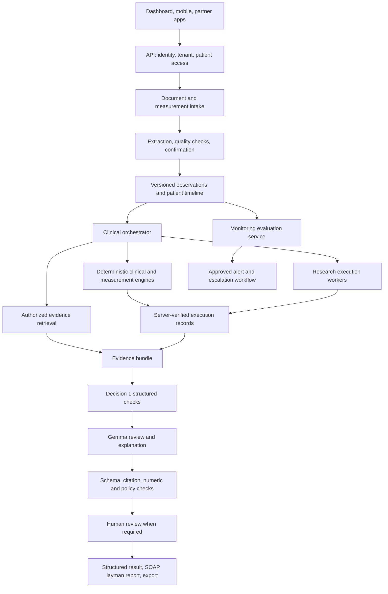

# ANUClaw: full product and implementation plan

Date: 17 November 2026  
Status: proposed implementation roadmap; checkboxes are incomplete unless explicitly marked.  
Scope: ANUClaw backend, dashboard, medical documents, clinical support, posture and ergonomics, monitoring, and research services.

## 1. Purpose and intended result

Build ANUClaw into an evidence-backed medical and research backend that can accept documents, measurements, and authorized patient context; execute appropriate tools and rules; and return traceable structured results, clinician drafts, and plain-language reports.

The first complete product workflow is:

**Upload a medical report → inspect extraction → confirm uncertain values → run sourced rules → retrieve relevant evidence → review the result → generate SOAP and layman reports → export with provenance.**

The longer-term platform connects that workflow to orthopedic and posture measurements, laboratory specialties, medication evidence, physiological monitoring, and reproducible research. Each department is a service module with defined inputs, tools, evidence, and release criteria. Adding a prompt or a skill does not establish a working department.

This file specifies work to build. It does not establish clinical validation, deployment readiness, regulatory status, or successful execution of proposed features. Creating this plan makes no application repairs.

## 2. Decisions carried forward

| Topic | Direction |
| --- | --- |
| Product architecture | BaaS-first: Backend as a Service for applications and integrations; dashboard as an operator and clinician client. |
| Initial delivery | Complete the medical-report workflow and foundation repairs before expanding specialties. |
| AI provider | OpenRouter, with credentials held on the server and excluded from logs, reports, and source control. |
| Reasoning preference | Medium where the selected model and endpoint support it. Capability checks must establish what was actually applied. |
| Proposed vision/OCR model | `google/gemini-3.8-flash`, evaluated against a repaired local PaddleOCR baseline. |
| Structured model checks | `google/gemini-decision-1` using the Decisions API. |
| Review model | `google/gemma-4-26b-a4b-it`; already a mixture-of-experts model. No conversion or training is needed for this use. |
| Proposed semantic retrieval | `google/gemini-embedding-2`, with authorization applied before candidate retrieval. |
| Clinical knowledge | Versioned, sourced, specialty-reviewed rules and reference documents. Model memory alone is insufficient. |
| Research execution | Actual approved tool execution with stored inputs, versions, results, and artifacts. |
| Clinical and research results | Explicit purpose, validation status, and access policy on every module and result. |

Model roles are product choices, not evidence of clinical performance. Verify provider capabilities, permitted data handling, availability, and budget before enabling a model for an environment. The platform must not claim that a model's internal experts are independently validated medical specialists.

## 3. Evidence and current baseline

Primary engineering evidence is the [17 November scan](docs/SCAN-2026-11-17.md). The implemented review contract is described in [engine-ai-review.md](docs/engine-ai-review.md). Those documents contain the source pointers behind the findings below.

| Component | Evidence available | Meaning for this plan |
| --- | --- | --- |
| Backend TypeScript | Build passed in the scan. | A useful foundation; runtime workflows still need verification. |
| Automated tests | 37 files / 267 tests passed in the scan. | Existing tests mostly cover CDS, engines, and helpers; end-to-end flows remain unproven. |
| Dashboard | Build passed after dependency installation. | Build success does not establish working uploads, tasks, authorization, or clinical results. |
| Lint | Failed because ESLint 9 has no applicable flat config. | Repair the checking environment. |
| PDF extraction | Installed `pdf-parse` v2 is called using the old callable API. | Confirmed source defect; repair before document analysis. |
| Local OCR | Legacy integration; service unavailable in the scan environment. | Pin dependencies and verify results in the intended environment. |
| Gemini OCR | Not integrated in the scanned runtime. | Proposed feature. |
| Decision 1 → Gemma review | Implemented for the E-LAB second-opinion route. | Limited coverage; reviews supplied evidence rather than automatically running engines. |
| Embeddings | No requested embedding integration or vector index found. | Proposed feature. |
| General vital-sign engine | No general sourced adult/pediatric implementation found. | Proposed feature; start with a clearly limited population. |
| Clinical rules | Some oncology, neurology, and PGx content explicitly uses seed data. | Review and release each ruleset separately. |
| Patient retrieval/auth | Source defects documented in the scan. | Foundation release blockers. |
| PostgreSQL / Docker / local HTTP services | Unavailable or not responding during the scan. | Runtime unverified; this alone does not prove their source implementation is broken. |
| Skills library | Numerous skill documents exist; external tools were not exhaustively executed. | Inventory and qualify capabilities individually. |
| Adjacent PosturePulse | Technical reference describes a separate capture/measurement stack. | Integration opportunity; documented implementation and validation claims must be checked against current code and runtime. |

The adjacent [PosturePulse reference](../../posturepulse-technical-reference.md) documents draft protocols, absent validated reference ranges, measurement uncertainty, and incomplete hardware calibration. Its measurement outputs must retain those limitations after integration. ANUClaw must not turn a proxy angle into a diagnosis or an unsupported health score.

No full build/test rerun is implied by writing this document. Reproduce the baseline when implementation starts.

## 4. Shared architecture

Begin with a modular backend and separate workers where execution or reliability requires them. Avoid splitting every specialty into a separate deployment before its interface and operational needs are known.



The diagram shows the target design. Monitoring alerts follow a dedicated evaluation and delivery path with specified deadlines. An urgent escalation must not wait for a conversational model response.

Shared services:

1. Identity, tenant membership, patient authorization, consent, and purpose of use.
2. Document/object storage and isolated temporary processing.
3. Extraction, observation normalization, correction history, and timelines.
4. Jobs, execution records, retries, cancellation, and artifact storage.
5. Versioned rule and engine registry with evidence and approval metadata.
6. Authorized knowledge retrieval, document versions, and citation resolution.
7. Model adapters, structured checks, generation, and review.
8. Report rendering, review/sign-off, exports, and integration events.
9. Audit, service health, quotas, cost tracking, and operational recovery.

## 5. Data contracts and traceability

Define schemas before connecting new models. Distinguish observed facts, patient-reported facts, calculations, model interpretations, and research predictions.

### 5.1 Core records

| Record | Required content |
| --- | --- |
| `Document` | Tenant, authorized patient association, purpose/consent reference, content hash, media type, page count, storage reference, upload and document dates. |
| `ExtractionRun` | Document/version, parser/OCR/model versions, page-level status, warnings, timestamps, raw artifact references. |
| `Observation` | Patient/encounter, concept, raw value and unit, normalized value and unit where valid, reference interval, method/specimen/device, measurement time, source location, quality and verification status. |
| `ObservationRevision` | Prior value, corrected value, actor, reason, time, and downstream results invalidated by the correction. |
| `CaseSnapshot` | Authorized record IDs, revision IDs, relevant context, missing inputs, purpose, and creation time. |
| `EngineRun` | Job/engine/version, input snapshot hash, execution status, inputs, result references, warnings, runtime and resource use. |
| `EvidenceItem` | Source, title, publisher, jurisdiction/population, version/date, exact supporting location, retrieval date, review status. |
| `ClinicalFinding` | Rule/version, required inputs, observed facts, result, applicability, evidence, and escalation/review status. |
| `ModelReview` | Model/provider, prompt/schema versions, actual supported settings, source bundle, structured checks, warnings, latency, usage. |
| `Report` | Source snapshot, findings, review status, author/reviewer, artifact hash, version, superseded report reference. |
| `Prediction` | Intended outcome/horizon/population, model version, inputs, prediction and uncertainty, applicability, validation status. |
| `Alert` | Source observations, evaluation rule, detected time, freshness, severity, recipient policy, acknowledgment and escalation events. |

Use explicit states such as `unverified`, `confirmed`, `unavailable`, `unsupported`, and `not_applicable`. A missing measurement must never become zero. Model-reported confidence is distinct from extraction accuracy, measurement uncertainty, and calibrated prediction probability.

### 5.2 Execution proof

An engine result must refer to a server-issued execution record bound to the tenant, patient/snapshot, engine version, input hash, status, and output hash. Validate ownership and hashes when consuming it. External evidence needs an authenticated import and provenance policy.

Caller-pasted JSON remains labeled external/unverified evidence. It cannot establish that an engine ran or that a workflow succeeded. A model's claim of successful computation is not an execution record.

### 5.3 Interoperability

Map atomic measurements to FHIR `Observation` and related diagnostic context to `DiagnosticReport`, with source and provenance links. Choose and pin the FHIR release/profile required by the actual integration; the reference links alone do not establish conformance. Use reviewed terminology mappings and explicit unit handling, including UCUM where appropriate. See [HL7 Observation](https://www.hl7.org/fhir/observation.html) and [DiagnosticReport](https://www.hl7.org/fhir/diagnosticreport.html).

Keep patient and tenant identifiers out of cross-tenant knowledge indexes. Research exports need an explicit authorization and de-identification path. Embeddings derived from patient data retain sensitive-data access and deletion requirements.

## 6. Model and engine responsibilities

| Layer | Assigned responsibility | Implementation requirement |
| --- | --- | --- |
| Native parser | Extract embedded PDF text and metadata. | Use the installed library API correctly; evaluate per page. |
| Local PaddleOCR | Local OCR option and baseline. | Pin the supported API/model, preserve layout and quality signals, return real error statuses. |
| Gemini Flash | Proposed image/table extraction and difficult-page assistance. | Page-grounded schema, explicit uncertainty, privacy policy, benchmark before promotion. |
| Embedding 2 | Similarity search over approved content. | Chunk/version metadata, scoped filtering, retrieval evaluation, reindex lifecycle. |
| Deterministic engines | Unit conversion, approved thresholds, calculations, measurement and statistical workflows. | Versioned implementation, complete required inputs, execution proof and applicability checks. |
| Decision 1 | Structured evidence completeness and consistency checks. | Endpoint-specific request/response validation; confidence is a model output, not clinical certification. |
| Gemma | Review, synthesis, and explanation grounded in supplied facts and evidence. | Schema validation, provenance, contradiction handling, numerical and citation verification. |
| Human reviewer | Confirm uncertain extraction and approve clinical content/decisions where the workflow requires it. | Appropriate role, recorded edits/sign-off, explicit responsibility. |

The existing Decision 1 → Gemma implementation is a starting point. Extend it through one orchestrator after execution records exist. Preserve the rule that an applicable engine block cannot be overridden by a model. Missing required evidence, invalid responses, or a failed mandatory stage must produce an explicit incomplete/failed state.

Medium reasoning is a configurable preference. Check endpoint/model support at startup or through a capability registry; record the applied setting or an explicit unsupported state. Never silently describe unsupported settings as active. Do not require or store hidden chain-of-thought; store concise conclusions and supporting evidence.

Model references checked for this plan: [Gemini 3.8 Flash](https://openrouter.ai/google/gemini-3.8-flash), [Gemini Decision 1](https://openrouter.ai/google/gemini-decision-1), [Gemini Embedding 2](https://openrouter.ai/google/gemini-embedding-2), and [Gemma 4 26B A4B](https://openrouter.ai/google/gemma-4-26b-a4b-it). These provider listings establish advertised capabilities, not performance on ANUClaw cases.

## 7. Medical-document, OCR, SOAP, and reporting workflow

### 7.1 Intake and extraction

- [ ] Accept PDF first; add image and DOCX support through separately tested adapters. Reject unsupported/encrypted inputs clearly.
- [ ] Validate file signature, size/page limits, authorized patient association, storage path, and request ownership.
- [ ] Process each page independently: native text where usable, OCR for image pages or low-quality extraction. Preserve both representations when reconciliation is needed.
- [ ] Preserve page/region coordinates, table structure, units, inequality signs, decimal points, dates, specimen details, and lab reference intervals.
- [ ] Detect duplicates, possible mixed-patient documents, rotated pages, ambiguous dates, conflicting values, and missing units.
- [ ] Present uncertainty and the source crop to a reviewer. Require confirmation for fields the configured policy considers critical or ambiguous.
- [ ] Treat every uploaded document as untrusted data. Instructions embedded in reports must never change system policy, execute tools, disclose records, or authorize actions.
- [ ] Apply the approved privacy policy before each external request, including image/page metadata and identifiers burned into images. Text replacement alone does not de-identify a page image.

### 7.2 OCR evaluation and selection

Build an authorized, annotated evaluation set covering native PDFs, scans, mixed pages, multipage tables, poor image quality, local lab formats, and supported languages. Evaluate local PaddleOCR and Gemini Flash on the same cases.

Measure field-level correctness for analyte, value, unit, interval, date, and patient association; critical-field errors; table-row matching; uncertainty routing; latency; and cost. Text character accuracy alone is insufficient. Fix numeric targets and confidence-interval requirements with the clinical owner before evaluating the held-out release set. Any observed silent critical-field error requires correction and regression review before that scope can pass.

Choose routing from those results. Native parsing should avoid unnecessary model calls. Keep explicit failure/retry/review behavior if the selected OCR service is unavailable. A second model's agreement does not establish ground truth.

### 7.3 SOAP contract

| Section | Allowed content |
| --- | --- |
| Subjective | Symptoms/history actually supplied by the patient or clinician, with source and date. Mark absent history as not provided. |
| Objective | Confirmed document values, validated measurements, dates, units, intervals, and source links. |
| Assessment | Attributed report conclusions and supported draft interpretations, clearly distinguishing uncertainty and hypotheses. |
| Plan | Source-attributed existing plans or evidence-grounded suggestions for clinician review. Identify the distinction. |

A lab report alone may provide almost entirely Objective content. Never invent symptoms, examination findings, diagnoses, prescriptions, follow-up completion, or clinician approval to fill a template.

### 7.4 Reports and exports

Produce structured JSON first, then render clinician and layman views from the same approved snapshot. Include what was measured, important findings with their source, plain-language meaning, limitations/missing context, questions for the treating clinician, and any approved escalation instructions.

The layman report must explain terms without converting a flagged lab result into a certain disease. Preserve caveats, dates, units, and the distinction between a lab interval and a clinical decision threshold. Clinical actions and medication changes require the applicable clinical workflow.

- [ ] Provide accessible HTML and PDF initially; add DOCX if needed by real users.
- [ ] Label draft/reviewed/superseded status visibly. A reviewed report becomes a new immutable version.
- [ ] Verify that every displayed number matches its structured source and that citations resolve to the claimed evidence.
- [ ] Render-check tables, pagination, long names, abnormal symbols, missing values, and links.
- [ ] Keep exports tenant-scoped and short-lived where shared; audit access and revocation.

The two previously supplied vitals PDFs can become authorized private regression fixtures. Create human-reviewed expected extractions before scoring them, keep them out of public source control, and supplement them with a larger independent evaluation set. A sample report artifact is not proof that the application pipeline works.

## 8. General vital-sign rules engine

Implement this as an actual deterministic module rather than a generation prompt.

1. Begin with a documented adult, non-pregnant outpatient scope. Pediatric, pregnancy, inpatient, exercise, and device-specific modules require their own approved rules.
2. Normalize supported measurements: pulse/heart rate, respiratory rate, temperature with method, systolic/diastolic pressure, oxygen saturation with oxygen/device context, weight/height, and explicitly supported derived values.
3. Preserve original units and convert only through tested dimension-aware functions. Reject ambiguous conversions.
4. Require measurement time and relevant context; identify stale readings, duplicates, outliers, and device-quality flags. An unusual value is not automatically a sensor error.
5. Evaluate versioned rules with source, population, setting, inclusion/exclusion criteria, effective dates, required inputs, and an accountable clinical approver.
6. Return `flagged`, `no_flag_under_selected_rules`, `insufficient_data`, `unsupported_population`, or `invalid_measurement`, with reasons and evaluated rule versions. A no-flag result does not establish overall health.
7. Evaluate an approved escalation policy on available eligible inputs without waiting for report generation. Missing context must not silently suppress an applicable urgent flag.
8. Generate language from those results; never let a model replace a threshold, calculation, or explicit unavailable state.

Acceptance: boundary and unit tests for each released rule; missing-context and unsupported-population cases; clinician-reviewed reference cases; measured alert behavior; and no enabled rule without its evidence and approval metadata. Do not put unsourced numerical treatment or emergency thresholds in this plan.

## 9. Specialty modules and departmental scope

Every specialty needs an owner, intended-use statement, supported inputs, evidence/rule versions, output schema, applicability limits, test cases, and approval status in the module registry.

| Department | Initial useful capability | Required inputs and engines | Release boundary |
| --- | --- | --- | --- |
| Orthopedics and rehabilitation | Summarize supplied imaging reports, symptoms, function, and longitudinal movement measurements. | Authorized clinical history, report text, validated motion/measurement adapters, reviewed outcome instruments where licensed. | Radiology-report summarization and camera measurements do not establish image-diagnosis capability. |
| Ergonomics | Assess documented task exposure and propose reviewed workplace adjustments. | Task, force/load, repetition, duration, workstation details, symptoms, suitable observed measurements. | Do not claim a complete RULA/REBA or similar assessment unless required inputs, method, and licensing are satisfied. |
| Posture and movement | Import quality-controlled angles/proxies, uncertainty, capture conditions, and repeat-session changes. | PosturePulse adapter, patient/session mapping, method and calibration versions, quality flags. | Preserve unsupported results, draft validation status, and proxy labels; avoid unsupported normality or disease claims. |
| Immunology | Explain supplied immunology panels and organize longitudinal assay results. | Assay/method, specimen, intervals, symptoms/history, medications, reviewed interpretation rules. | No autoimmune or immune-deficiency diagnosis from an isolated marker. |
| Haematology and clinical pathology | Structure CBC, chemistry, and coagulation panels; highlight reviewed patterns and changes. | Units, specimen, dates, analyzer/method where relevant, lab intervals, confirmed values. | Smear, histology, and image interpretation need separately validated imaging modules. |
| Virology and molecular diagnostics | Explain existing PCR/antigen/antibody and other assay reports in context. | Specimen, assay, collection/onset dates, lab interpretation, assay quality/control status where reported. | No cross-assay interpretation of Ct as a universal viral-load or infectiousness measure. |
| Internal medicine and infectious diseases | Build a chronological problem/evidence summary and clinician-review questions. | Symptoms, diagnoses, medication/allergy list, labs, imaging reports, exposures and prior decisions when supplied. | Preserve missing information; treatment recommendations require approved local clinical workflows. |
| Biostatistics and clinical research | Execute reproducible descriptive analysis and approved study analyses. | Dataset dictionary, protocol, endpoints, analysis plan, versioned statistical scripts. | Return executed results and assumptions; do not fabricate significance, datasets, or completed studies. |
| Epidemiology | Produce authorized cohort trends, rates, and surveillance summaries. | Case definitions, denominators, period/location, sampling and reporting-delay metadata. | Address representativeness and privacy; population associations do not establish individual diagnoses or causality. |
| Clinical pharmacology | Reconcile supplied medicines and explain sourced interaction, renal/hepatic, allergy, and PGx considerations. | Verified medication list, clinical context, licensed/versioned knowledge sources, validated rules. | A licensed clinician controls prescribing and changes; seed PGx content stays disabled for clinical use. |
| Drug discovery | Run approved computational research and summarize reproducible results. | Validated structures/targets, dataset provenance, approved docking/ADMET/PK-PD tools, versions and artifacts. | Computational rankings remain research findings until the appropriate independent validation. |
| Emergency medicine | Create timely handover summaries and support locally approved escalation protocols. | Fresh data, local workflow, approved rules, accountable recipients, tested delivery/acknowledgment. | Release emergency alerts only after deadline, availability, workflow, and clinical validation gates. |
| Physiological monitoring | Ingest authorized device observations, show trends, quality, gaps, and approved alerts. | Device identity, calibration/quality, timestamps, units, patient pairing, reconnect behavior. | No continuous-monitoring claim without measured end-to-end reliability and supported device scope. |
| AI prediction | Estimate a predefined outcome over a defined time horizon for an eligible population. | Versioned datasets, outcome labels, reproducible training and external/prospective evaluation. | Remain research-only until discrimination, calibration, utility, subgroup and workflow criteria are met. |
| Biomarker discovery | Explore reproducible candidate associations and replication plans. | Assay QC, cohort metadata, batch/confounder handling, independent datasets and executed analysis. | Candidate associations require analytical and clinical validation before clinical claims. |
| Synthetic biology and broader life science | Organize literature, approved design records, provenance, and reproducible computational research. | Research-purpose workspace, expert review, appropriate domain tools and versioned artifacts. | Define each project's scope separately; no automatic transition from a model proposal to a clinical or experimental claim. |

The ergonomics scope includes force, repetition, awkward/static posture, and exposure context, consistent with [NIOSH risk-factor guidance](https://www.cdc.gov/niosh/ergonomics/ergo-programs/risk-factors.html). These inputs cannot all be inferred from a still image.

### 9.1 PosturePulse integration instructions

- [ ] Inspect the current adjacent `services/ml-service`, `services/backend-api`, `packages/schemas`, and mobile capture contracts before designing the adapter.
- [ ] Preserve the service boundary: its measurement worker computes the geometry; ANUClaw consumes the versioned results and explains their documented scope.
- [ ] Establish an authorized subject/session mapping and verify consent/purpose across both systems. Never join solely by patient name.
- [ ] Preserve raw metric, unit, uncertainty, method, view, quality status/reason, capture time, and calibration/protocol version.
- [ ] Preserve `unsupported` and `notMeasurable` results and reported symptoms. Do not fill missing angles with model estimates.
- [ ] Do not import bony-landmark reference ranges into camera proxy metrics without validation of that exact construct.
- [ ] Evaluate repeatability and agreement against a suitable reference under a prespecified study, across devices, capture conditions, and relevant participant groups.
- [ ] Require uncertainty-aware longitudinal comparisons. Distinguish a change in measurement from a clinically meaningful improvement.
- [ ] Keep symptom-driven pause/escalation precedence intact. An AI explanation must not resume a paused capture session.

### 9.2 Monitoring and emergency instructions

Use device-specific adapters and timestamped observations. Include source clock, receipt time, freshness, sampling/gap information, patient pairing, artifact flags, and quality limitations. Pulse oximetry, for example, has documented accuracy limitations that must remain visible; see the [FDA pulse-oximeter reference](https://www.fda.gov/medical-devices/products-and-medical-procedures/pulse-oximeters).

Define alert latency and availability objectives with the responsible clinical service before a pilot. Test duplicate and out-of-order observations, clock drift, sensor dropout, stale data, disconnection, provider failure, missed acknowledgment, and delivery escalation. Persist alert state and recipient responsibility. Silence or loss of connection must never display as a normal measurement.

Start with retrospective summaries and a supervised monitoring pilot. Emergency use requires its own intended-use review, clinical protocol approval, measured operating performance, drills, and downtime procedure.

### 9.3 Prediction and biomarker instructions

For each proposed prediction: define the decision it supports, outcome, prediction horizon, target population, timing of available predictors, baseline comparator, and clinical utility criterion before model fitting. Use subject/site/time-aware splits appropriate to the question, prevent leakage, and keep a locked independent evaluation set.

Report uncertainty, discrimination, calibration, missing-data handling, subgroup performance, external evaluation, and prospective workflow evidence. Record dataset, code, and model versions plus monitoring and rollback criteria. A general-purpose model's confidence field is not a validated risk score.

For biomarker discovery: prespecify endpoints where appropriate, inspect assay quality/batch effects, address confounding and multiple comparisons, distinguish exploratory from confirmatory analysis, and replicate independently. Separate measurement reliability, clinical association, and demonstrated clinical usefulness. No claimed discovery from generated prose or an unreplicated correlation.

## 10. Knowledge, embeddings, and evidence management

Embeddings can improve retrieval; their value depends on the corpus, metadata, permissions, and measured retrieval quality. They do not replace OCR, deterministic rules, or clinical approval.

- [ ] Separate approved reference knowledge from patient records and research datasets, with distinct access policies.
- [ ] Admit sources through a review process: provenance, license, scope/population, jurisdiction, publication/effective date, update cadence, and owner.
- [ ] Chunk by meaningful section/table and preserve exact page/section anchors and document version.
- [ ] Implement the Embedding 2 adapter; choose dimensions and index type through measured recall, latency, and storage tradeoffs.
- [ ] Apply tenant/patient/purpose authorization before retrieval candidates are formed. Similarity ranking is not an access-control mechanism.
- [ ] Add metadata filters, keyword retrieval where useful, and explicit no-evidence handling. Record retrieved and actually cited items.
- [ ] Benchmark retrieval on clinician-authored questions, including conflicting guidelines, obsolete content, and unsupported questions.
- [ ] Propagate source replacement/deletion into chunks, embeddings, caches, and generated report dependency records according to retention policy.
- [ ] Require claim-to-source checks. Reject invented citations and flag sources that do not support the claim.

## 11. Proposed ANUClaw skills catalog

These are proposed application skills, not installed Codex skills. Extend or consolidate the existing medical-report analyzer rather than duplicating it. First audit the current library for equivalent capabilities and working tools.

Every skill package must define its purpose, inputs/schema, required tools, permission scope, evidence sources, procedure, output schema, failure behavior, examples, tests, owner, and version. A missing tool must produce an unavailable state. A skill must not invent execution results.

| Proposed skill | Responsibility | Prerequisites |
| --- | --- | --- |
| `anuclaw-document-intake` | Validate/classify and register authorized documents. | Intake and storage service. |
| `anuclaw-ocr-layout` | Extract page-grounded text/tables and route uncertainty. | Verified OCR adapters. |
| `anuclaw-report-normalizer` | Convert confirmed extraction into typed observations. | Observation schema and units. |
| `anuclaw-medical-report-analyzer` | Extend the existing package to coordinate report analysis. | Orchestrator, approved engines and evidence. |
| `anuclaw-soap-drafter` | Draft source-attributed SOAP with explicit missing sections. | Confirmed snapshot and SOAP contract. |
| `anuclaw-layman-explainer` | Explain approved findings in plain language. | Evidence-backed findings and review policy. |
| `anuclaw-report-exporter` | Render consistent HTML/PDF and optional DOCX. | Report schema and rendering service. |
| `anuclaw-vitals-rules` | Invoke and explain the approved vital-sign module. | Released ruleset and required context. |
| `anuclaw-evidence-retriever` | Retrieve authorized, versioned reference material. | Scoped knowledge service. |
| `anuclaw-engine-evidence-review` | Coordinate execution records, Decision 1, and Gemma review. | Verified engine records and model adapters. |
| `anuclaw-longitudinal-summary` | Summarize comparable observations and changes. | Timeline, method/unit comparability. |
| `anuclaw-posture-measurements` | Import and explain quality-controlled posture measurements. | PosturePulse adapter and preserved limitations. |
| `anuclaw-ergonomics-assessment` | Assess complete documented workplace/task inputs. | Approved method and required exposure data. |
| `anuclaw-ortho-rehab-summary` | Organize symptoms, function, supplied reports and recovery. | Relevant approved sources and tools. |
| `anuclaw-immunology-summary` | Explain assay-specific immunology results. | Reviewed specialty rules. |
| `anuclaw-haematology-pathology-summary` | Structure and explain supported lab patterns. | Lab normalization and approved rules. |
| `anuclaw-molecular-diagnostics-summary` | Explain supplied molecular/virology results. | Assay-specific context and sources. |
| `anuclaw-internal-medicine-summary` | Coordinate a multisystem evidence timeline. | Authorized comprehensive case snapshot. |
| `anuclaw-medication-evidence` | Reconcile and explain sourced medication considerations. | Verified list, licensed evidence and clinical rules. |
| `anuclaw-monitoring-summary` | Explain device trends, gaps and quality. | Reliable device observation service. |
| `anuclaw-emergency-handover` | Draft concise handover from current verified facts. | Local workflow; independent escalation service. |
| `anuclaw-biostatistics` | Run approved reproducible statistical analyses. | Dataset governance and execution environment. |
| `anuclaw-epidemiology` | Compute documented cohort/population summaries. | Authorized data and valid denominators. |
| `anuclaw-drug-discovery-research` | Coordinate approved computational research tools. | Tool qualification and artifact capture. |
| `anuclaw-prediction-evaluation` | Train/evaluate defined research prediction tasks. | Protocol, governed data and validation pipeline. |
| `anuclaw-biomarker-research` | Explore and replicate candidate associations. | Assay QC and approved analysis plan. |
| `anuclaw-life-science-research` | Organize approved life-science literature and computational projects. | Project-specific scope and qualified tools. |

Skill packages describe procedures. Backend services enforce access control, execute tools, calculate results, and preserve audit records. Medical knowledge requires a maintained evidence process in addition to skill instructions.

## 12. Dashboard plan

The dashboard should expose the real state of the backend. Remove unsupported success claims and connect each visible control to a verifiable operation.

| Workspace | Required behavior |
| --- | --- |
| Overview | Real counts, service health, pending reviews, failed/stalled jobs, supported modules and their validation status. |
| Patient timeline | Authorized patient context, source dates, confirmed observations, corrections, reports and comparisons. |
| Document review | Original page beside extracted fields, uncertainty markers, correction/confirmation actions. |
| Clinical report | SOAP and layman views, evidence links, missing context, draft/review/sign-off state. |
| Posture and ergonomics | Capture quality, methods/proxies, measurement uncertainty, exposure inputs and valid comparisons. |
| Specialty modules | Enabled scope and required inputs; clear unsupported/unavailable states. |
| Engine runs | Actual execution status, input snapshot, engine/version, artifacts, warnings and review results. |
| Monitoring | Freshness, gaps, device connection/quality, trends, acknowledgment/escalation where enabled. |
| Research | Dataset/protocol, execution artifacts, reproducible analyses, candidate findings and validation status. |
| Tasks and pipelines | Real queue state, graph execution, retries/cancel, error propagation and actual run history. |
| Administration | Membership, clinical provisioning, consent/purpose, provider policies, quotas, audit and retention. |

- [ ] Reject malformed engine JSON visibly; never silently drop an intended block.
- [ ] Distinguish queued/running/failed/completed from clinically reviewed/approved.
- [ ] Distinguish extraction confirmation, engine execution, model review, and clinician sign-off.
- [ ] Display the evidence behind a finding and the scope in which a module is approved.
- [ ] Keep demo fixtures explicitly labeled and isolated from live records.
- [ ] Show incomplete/stale/unavailable data honestly; avoid default healthy or completed states.
- [ ] Verify access, upload, correction, execution, review and export through end-to-end tests.

## 13. BaaS interface and runtime operations

Implement versioned contracts for documents, observations, snapshots, engine jobs, reports, evidence, and enabled monitoring/research capabilities. Route names below are proposed contracts, not existing endpoint claims:

| Proposed API family | Purpose |
| --- | --- |
| `/v1/documents` | Intake, extraction job and source-page access. |
| `/v1/patients/{id}/observations` | Authorized observations, revisions and timeline. |
| `/v1/cases/{id}/analyses` | Start an analysis bound to a case snapshot and module set. |
| `/v1/jobs/{id}` | Status, errors, cancellation and result references. |
| `/v1/reports/{id}` | Draft/review versions and controlled exports. |
| `/v1/engines` | Enabled capabilities, versions, requirements and validation status. |
| `/v1/research/runs` | Separately authorized reproducible research execution. |
| `/v1/monitoring` | Enabled device ingestion, status and approved alert operations. |

Before adding endpoints, inventory existing API/dashboard routes and decide whether to adapt, version, or retire each one. Avoid maintaining conflicting orchestration paths.

Required behavior: OpenAPI and schema validation; tenant-aware user/service identities; idempotency on repeatable submissions; durable jobs; bounded timeouts/retries; stable error codes; authenticated artifact access; signed outbound webhooks where used; rate and spend limits; and observable failure states. Do not put patient data or credentials in webhook URLs.

Reuse PostgreSQL as the durable metadata foundation where appropriate. Evaluate a durable job table/queue and pgvector or another index through actual workload needs. Use object storage for large source/artifact files. Keep clinical policy and tenant scope consistent across the dashboard, API, scheduled work, tools, and channels.

Document startup, readiness/liveness, dependency checks, schema migration/rollback, backup/restore, secret rotation, retention/deletion, provider outages, and incident recovery. BaaS architecture does not itself provide patient isolation, compliance, or operational reliability.

## 14. Repair backlog mapped to the scan

The IDs below are implementation work packages, not claims that every risk has been exhausted.

| ID | Action and principal source areas | Required acceptance evidence |
| --- | --- | --- |
| F01 | Scope patient retrieval in `src/rag.ts` and every calling context. | Cross-tenant/patient requests denied; no unrelated record enters prompts, caches or results. |
| F02 | Repair dashboard secret/session/password/bootstrap behavior in `auth.ts`, `routes/users.ts`, `db/connection.ts`. | Startup fails without required production secrets; missing/revoked sessions rejected; secure account bootstrap and password migration tested. |
| F03 | Fail closed for clinical auth and replace unconditional grants in CDS middleware and `routes/elab-engine.ts`. | Role/purpose/MFA/domain checks tested across API and dashboard; demo mode explicitly isolated. |
| F04 | Centralize pre-egress policy across uploads, RAG, models, images and audit. | Payload-capture tests show only permitted data leaves; logs omit sensitive text and credentials; policy enforced on all paths. |
| F05 | Restore a reproducible local runtime: DB, API, dashboard, OCR and selected execution workers. | Fresh documented setup, health checks, migrations in an isolated test DB, and successful service smoke tests. |
| F06 | Repair `pdf-parse` v2 integration and page-based OCR in `routes/elab.ts`, `src/ocr.ts`, `ocr_server.py`. | Text/scanned/mixed/malformed PDFs, explicit errors, preserved field/source structure and comparison benchmark. |
| F07 | Unify scheduled-task storage and execution in `routes/tasks.ts`, `task-scheduler.ts`. | Real execution, correct group mapping, schedule edits/restarts, cancellation and failure records. |
| F08 | Execute pipeline graphs and propagate returned errors in `routes/pipelines.ts`. | Graph ordering/dependencies, cycle/invalid-edge rejection, node failure and retry behavior tested. |
| F09 | Repair EHR route order and persistence in `src/api/routes/ehr.ts`. | Search reaches its handler; create/update succeeds only after authorized transactional persistence; failures return errors. |
| F10 | Define container bootstrap/media/credential contract and fallback semantics in `container-runner.ts`, `container/Dockerfile`. | Isolated tool smoke tests; mounted media reachable; credentials handled securely; timeout/provider/tool absence produces accurate errors. |
| F11 | Enforce hooks and policy through one orchestrator across message/upload/pipeline/task paths. | Modified prompts used; required denies/errors enforced; tool and output gates cannot be bypassed by alternate entry points. |
| F12 | Generalize verified evidence review beyond second opinion. | Server-owned execution records, schema checks, mandatory-review failure behavior and block precedence tested across supported entry points. |
| F13 | Replace or disable seed clinical content pending specialty review. | Every enabled clinical rule has valid sources, scope, approval and reference cases; no placeholder evidence. |
| F14 | Implement scoped embedding retrieval and general vitals modules. | Retrieval authorization/evaluation, rule applicability and approved reference cases meet release criteria. |
| F15 | Complete or disable incomplete Nostr/Feishu/DingTalk adapters. | Actual authorized inbound/outbound behavior demonstrated, or unsupported capability clearly hidden/disabled. |
| F16 | Enforce tenant rate, concurrency, resource and spend limits. | Budget/limit boundary tests, fair queue behavior, clear client errors and audit. |
| F17 | Supply ESLint 9 config and maintain build/check commands. | Backend/dashboard builds, meaningful tests and lint pass in the documented environment. |

## 15. Implementation phases and completion gates

Assign an engineering owner and a clinical/domain owner where applicable before each phase starts. Replace effort estimates with measured milestones after the foundation work; calendar promises would be unreliable before runtime restoration and dataset review.

### Phase 0 — establish the working baseline

- [ ] Inventory existing services, routes, skills, dependencies, data stores, model calls and external tools; classify implemented, partial, stubbed, unverified and proposed capabilities.
- [ ] Preserve unrelated workspace changes; work in an isolated branch/checkpoint where available.
- [ ] Reproduce builds/tests/lint and service status without exposing credentials or using production records.
- [ ] Prepare a synthetic test tenant, patient set and isolated database/storage.
- [ ] Record model capabilities and a local setup/runbook; link every new task to this plan and its evidence.

Exit: a reproducible baseline, owned backlog, and an environment suitable for meaningful integration tests. No production migrations or deployment are implied by this planning document.

### Phase 1 — trustworthy foundation and execution

Implement F01–F05, F07–F11, F16–F17. Disable unqualified clinical rules and incomplete adapters while their work is pending. Establish data contracts and server-owned execution records.

Exit: authorization tests pass; secrets/bootstrap and clinical grants behave correctly; egress policies cover every active path; services run; tasks/pipelines/EHR operations report actual outcomes; required policy blocks cannot be bypassed; build/test/lint checks pass.

### Phase 2 — complete medical-report workflow

Implement F06 and the document/observation/correction/report services. Extend the existing analyzer skill, SOAP drafting, layman explanation and HTML/PDF rendering. Start scoped knowledge ingestion and the model adapters required for the report flow.

Exit: native/scanned/mixed reports complete the workflow; uncertain fields reach confirmation; embedded instructions cannot control execution; missing SOAP sections stay explicit; exports match the same structured snapshot; failures never become successful reports. Human-reviewed regression expectations include the two supplied PDFs plus additional cases.

### Phase 3 — clinical engines, evidence retrieval and general review

Implement F12–F14 for the initial adult vitals scope and selected reviewed laboratory rules. Complete authorized embedding retrieval and the Decision 1 → Gemma evidence-review path.

Exit: every released rule is sourced and approved; boundary/applicability tests pass; real engine records are consumed; model failures preserve incomplete states; citations and numeric fidelity pass evaluation; no unrelated patient data can be retrieved.

### Phase 4 — posture, ergonomics and orthopedic workflow

Integrate the adjacent PosturePulse service after checking current contracts. Add symptom/function context and task exposure inputs. Produce source-linked measurement reports and conservative longitudinal comparisons.

Exit: authorized identity/consent mapping, preserved quality/uncertainty/proxy status, measured adapter behavior, and clinician-reviewed interpretation boundaries. Clinical measurement claims remain gated by the actual validation study and evidence.

### Phase 5 — laboratory specialties and medication evidence

Expand haematology/pathology, immunology, molecular diagnostics, internal medicine/infectious disease and pharmacology one module at a time. Qualify knowledge licenses, assay-specific context, local clinical protocols, and PGx rules independently. Address existing oncology/neurology seed modules through the same process.

Exit per module: owned intended-use statement, reviewed evidence, complete input schema, representative evaluation cases, honest unavailable states, clinical approval for its released scope, and monitored pilot results.

### Phase 6 — physiological monitoring and emergency workflow

Start with historical trend review, then a supervised monitoring pilot. Add validated alert rules, recipient acknowledgment, delivery escalation and downtime handling. Emergency deployment has an additional gate independent of a general dashboard release.

Exit: supported-device scope, measured latency/availability, artifact/stale-data handling, reliable recipient workflow, clinical protocol approval, drills and operational support ownership.

### Phase 7 — research, epidemiology, discovery and prediction

Build governed research workspaces and reproducible execution for biostatistics, epidemiology, pharmacology/drug discovery and approved broader life-science projects. Add prediction and biomarker projects only with explicit protocols and appropriate datasets.

Exit: executed artifacts and reproducibility for research services; external/replication/prospective evidence appropriate to each claim; research-only labels maintained until an additional clinical release gate is satisfied.

Research infrastructure may progress in parallel once its data, authorization and execution dependencies are ready. It must not delay the first complete report workflow or inherit unearned clinical approval.

## 16. Verification and release criteria

### 16.1 Engineering checks

Run the existing commands in the ANUClaw directory as applicable:

```sh
npm run build
npm test
npm run lint
npm --prefix dashboard run build
```

Add integration/e2e checks around the actual behavior being changed. Use isolated databases and authorized fixtures. External provider mocks establish failure handling and contract behavior; separately labeled live tests establish provider connectivity and observed behavior. Neither proves clinical validity.

Required failure cases include tenant/patient mismatch, missing/revoked sessions, missing secrets, parser failure, corrupt/large files, model malformed output/timeouts, OCR uncertainty, unavailable tools, duplicate job submissions, pipeline failure, absent evidence, stale data, and mandatory-review failure.

### 16.2 Clinical and measurement evaluation

For each module, define the intended use, population, reference standard, sampling approach, metrics, uncertainty, subgroup analysis, numeric acceptance targets, and accountable reviewers before locked evaluation. An observed failure must have a disposition and regression case. Passing unit tests alone cannot satisfy this gate.

Evaluate extraction factual accuracy, invented-fact rate, citation support, numeric fidelity, appropriate missing-data behavior, escalation performance, and human usability. Evaluate posture agreement/repeatability and prediction calibration separately using methods suited to those outputs.

### 16.3 Release gates

| Gate | What must be evidenced |
| --- | --- |
| Engineering ready | Reproducible environment; builds/tests/lint; durable jobs; honest failure states; deployment/rollback procedure. |
| Data ready | Authorization and isolation; permitted provider handling; provenance, correction, retention and deletion behavior. |
| Module ready | Defined scope, approved content, required inputs, independent evaluation and known limitations. |
| Workflow ready | Successful supervised end-to-end use; roles/sign-off, usability, support and downtime handling. |
| Clinical claim ready | Clinical validation and applicable deployment/intended-use requirements evaluated by responsible experts. |

Track extraction error and review rates, unsupported-question behavior, citation/numeric errors, job failure rate, latency, provider cost, stale-data events and alert delivery performance. Establish limits with owners and suspend/rollback the affected module when its release assumptions no longer hold.

## 17. Ownership, unresolved choices and immediate next work

| Workstream | Accountable role |
| --- | --- |
| Backend contracts, isolation, jobs and execution | Backend lead. |
| Clinical rules, report semantics and escalation | Named licensed clinical lead, with specialty reviewers. |
| OCR, retrieval and model evaluation | ML/evaluation lead with annotated reference data. |
| Posture measurement and study design | Measurement/biomechanics lead and clinician investigator. |
| Statistical/research/prediction protocols | Biostatistician and domain research lead. |
| Dashboard and export usability | Frontend/product lead with actual clinical users. |
| Operations, data handling and deployments | Operations/security/data-governance owners. |

Resolve before the dependent release: first user group and deployment geography; initial adult/lab scope; supported languages and assays; provider data-processing terms; reference-content licenses; clinician provisioning/sign-off; monitoring devices and alert responsibility; study datasets and approval; and numerical release targets. These choices must be documented rather than guessed by an AI response.

Immediate implementation order:

1. Reproduce the baseline and inventory current entry points.
2. Repair patient isolation, auth/provisioning, and pre-egress policy.
3. Restore and prove runtime/tool execution, durable tasks, pipelines, EHR persistence, and policy enforcement.
4. Repair page-level PDF/OCR and build extraction confirmation.
5. Deliver the complete source-linked report → SOAP → layman → export flow.
6. Add approved vitals rules, scoped retrieval, and execution-backed Decision 1 → Gemma review.
7. Integrate posture/ergonomics, then qualify specialties, monitoring and research through their own gates.

The first milestone is achieved when an authorized user can submit a supported medical report, inspect and correct its extracted facts, run the enabled approved rules, receive an evidence-linked draft and layman explanation, and export a reviewed version with accurate status and provenance—even when a dependency fails or required information is missing.
